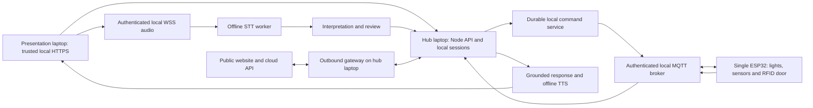

> Hindi/chat/wake follow-up, 2026-11-15: automatic replies use actual recognized words, including Hindi under an English decoder hint. Manual mic and manually started conversation never require a wake word. Optional Settings wake listening accepts Shrimaan/Shreeman/Shiman and Hindi forms on visible pages, pauses during replies, and has a global Stop control. Reload preserves only the option, never silently starts the microphone. Live chat retains up to 40 turns in memory; home/account changes and refresh clear it. Browser provider/network limitations and physical confirmation rules remain. See docs/verification/BROWSER_VOICE_ASSISTANT.md for current behavior and isolated evidence.

> Current voice update, 2026-11-15: [browser conversation implementation](../docs/verification/BROWSER_VOICE_ASSISTANT.md). The user has replaced native speech with browser Web Speech recognition/synthesis and authenticated final-text WebSocket validation. No HomeAuto speech models or Python workers load. Downloaded assets/environments were moved outside the project into a recoverable archive; old native instructions and measurements below are historical. Start conversation alternates listening and speech with a 350ms quiet buffer. Browser recognition may require internet, and Automatic listening follows the app language rather than promising portable bilingual detection. Device execution, authentication and physical confirmation rules remain on the hub.

# Shrimaan — implemented local CPU speech

Scoped conversation update, 2026-11-15: the hub now answers greetings, help/capability requests and out-of-scope questions in English/Hindi through a small rule-based dialogue layer. Clear non-command transcripts reach spoken scope guidance. Device controls retain strict interpretation and authorization; no open-domain LLM or Live API was added. Approved fixed replies use bounded RAM and verified persistent audio caches; recordings, readings and action confirmations are excluded. Both native processing bounds are 60s with 65s browser bounds. See [current behavior and native evidence](../docs/verification/OFFLINE_SCOPED_ASSISTANT.md). Speech models remain Whisper medium/Kokoro, and recognition latency remains a hardware constraint.

Listening upgrade, 2026-11-14: multilingual Whisper medium with CPU INT8 faster-whisper replaces the active small Vosk recognizers. Kokoro English/Hindi spoken output remains. See [current installation and acceptance](../docs/verification/WHISPER_UPGRADE.md) for actual status, hashes, timings and limitations. Earlier Vosk results below are historical, not evidence of the replacement's quality.

Demo behavior update2026-11-14: the current local simulation uses automatic speech endpointing after approximately1.8seconds quiet, then automatically executes clear non-sensitive simulated controls and speaks the result. Explicit real-device review and sensitive-action denial remain. Earlier manual Finish recording/review demo notes are historical. Current verification and limitations: [DEMO_VOICE_REPAIR.md](../docs/verification/DEMO_VOICE_REPAIR.md).

Latest delivery priority (2026-11-14): the user requests a detailed Windows launcher/installation handoff for SOL6.1. See [LOCAL_AI_IMPLEMENTATION_PLAN.md](../docs/LOCAL_AI_IMPLEMENTATION_PLAN.md) for the canonical file-level plan, first-run/offline installation, managed runtime/model provisioning, local accounts, website guidance and acceptance tests. Local packaging can be implemented before physical commissioning; the hardware gates below still apply to actual device release. No launcher has been implemented by this planning update.

## Revised hub ownership — 2026-11-14

User revision: all English/Hindi speech and conversation processing runs on the computer connected to ESP32. Remote website clients capture/play audio and use that running hub, without installing models themselves. The hub must stay powered, awake and connected for remote voice and control. Local/LAN operation remains available without internet. The target remote relay is specified in [HUB_AI_EXECUTION_PLAN.md](../docs/cloud/HUB_AI_EXECUTION_PLAN.md); it supersedes earlier local-only product restrictions below. Current cloud voice remains unimplemented/disabled until that relay passes verification.

## Current implementation plan — 2026-11-14

This section supersedes deployment assumptions in the historical revision below. User-confirmed topology: one laptop runs automation and all local AI; one ESP32 serves lights, gas/motion sensors and RFID door control together; a second laptop presents the interface. Commands travel over Wi-Fi. USB may supply power/programming and is not the command transport. The public website is also intended for remote access. Exact ESP32 variant and wiring still need bench verification. First speech scope is provisionally Indian English, Hindi and Hinglish; other languages need explicit coverage and evaluation.

### Architecture and current boundaries

The two laptops and ESP32 can share a private Wi-Fi router without an internet connection. USB power/programming is compatible with this MQTT arrangement. Existing source has **no USB serial command transport**: if cable-only operation is required, implement a separate bounded serial adapter and matching firmware protocol; plugging in a USB cable alone does not provide app control. Do not silently bridge USB and MQTT into two simultaneous command owners.

Run speech on the hub laptop, not ESP32 or Vercel. The second laptop opens the hub's LAN HTTPS address and sends microphone PCM directly to that hub. Configure explicit allowed hosts, a trusted certificate with the correct SANs, and private-subnet firewall rules. Loopback localhost on laptop B means laptop B, not the hub. Use the real local runtime and local account for hardware presentation; the login-free preview is simulated. Cloud accounts and local accounts are separate today.

Public website controls use the existing outbound HTTPS gateway, with its enrollment and default-off physical gates. No inbound router port is required. Internet loss leaves local operation available, but the public website cannot reach the home then. Cloud voice routes currently return LOCAL_VOICE_ONLY. Remote text/manual control is distinct from remote microphone conversation. The current working demo uses the local URL for speech. The now-required remote-audio implementation must explicitly choose a trusted private-network connection or a scoped encrypted relay with bounded buffers, consent, ownership and expiry; the current telemetry gateway does not carry audio. Do not add a cloud speech provider to achieve this.

### Evidence and model selection

Current host inspected: Intel i5-12450H, approximately15.7GiB RAM. This describes the development host; confirm that it is the intended presentation hub. Native workers were rerun using an in-memory repository and synthetic audio on2026-11-14. English text round-tripped correctly; Hindi input “कमरा एक की लाइट बंद करो।” became “कमरे की लाइट बंद करो”, losing the room number. English TTS/STT took approximately705/634ms; Hindi1006/567ms in this short probe. These are worker timings, not end-to-end human latency or accuracy. Evidence: `D:/homeauto-audit-tools/iot-ai-20261114/speech/results.json`.

| Candidate | Role and decision | Primary reference |
|---|---|---|
| Installed Vosk English-US + Hindi | Retain as measured baseline; installed English README explicitly says US English. Not Indian-accent validated. | [Vosk models](https://alphacephei.com/vosk/models) |
| Vosk small Indian English + Hindi | First inexpensive challenger to the current English model. Benchmark the same held-out speakers; its regional label alone does not prove improvement. | [Official model catalog](https://alphacephei.com/vosk/models) |
| Multilingual Whisper via whisper.cpp | Laptop challenger for Hindi/English and code switching; compare quantized Base/Small under identical load. Earlier synthetic tests did not justify promotion. Pin model, runtime, decoding options and language mode. | [whisper.cpp](https://github.com/ggml-org/whisper.cpp) |
| AI4Bharat IndicConformer | Optional Hindi/additional-language challenger. Official600M model covers22 scheduled Indian languages; this is not proof of Indian-English or Hinglish performance. Model download is gated; inspect/pin its custom inference code before provisioning. | [Official model card](https://huggingface.co/ai4bharat/indic-conformer-600m-multilingual) |
| Installed Kokoro ONNX | Retain English/Hindi output as baseline. Current English voice is American; upstream Hindi voice grades are modest. Native-listener auditions are required, especially names, numbers and negation. | [Official voice inventory](https://huggingface.co/hexgrad/Kokoro-82M/blob/main/VOICES.md) |
| IndicF5 | Optional Indic-language TTS challenger after baseline testing. Evaluate resource cost and authorized reference-voice requirements; not a promised drop-in Indian-English voice. | [Official repository](https://github.com/AI4Bharat/IndicF5) |
| Silero VAD | Candidate replacement for fixed RMS endpointing; evaluate soft voices, noise, clipping and false speech before integration. | [Official repository](https://github.com/snakers4/silero-vad) |

Selection is a controlled experiment, not a model-name commitment. An Indian English accent is different from speaking an Indian language. Hindi support does not imply Tamil, Marathi or Bengali support, and independently running English/Hindi models is not a dedicated code-switching model. Retain raw transcripts alongside normalized interpretation; never repair missing negation/numbers by guessing a device. Pin hashes, dependencies, licenses and a rollback profile. Provision files once, then prove cold boot with internet blocked and no missing tokenizer/phonemizer downloads. Offline environment flags alone are not a network isolation test.

The diagram above shows the currently implemented local speech path. The revised target also routes remote audio/conversations from the public website through a scoped relay to the hub and returns hub-generated audio; see the authoritative revised contract.

### Ordered delivery plan

1. **Confirm one-board hardware profile.** Record exact ESP32 variant, relay polarity/supply, connected loads, sensors, RFID, lock/indicator and wiring. Lights-only can use the lights controller profile. An all-in-one board needs new combined firmware and an explicitly reviewed GPIO map: current light pins4/5/18/19 collide with door relay4 and RFID SPI/SS5/18/19. Preserve logical topic vocabulary; define combined-board health and least-privilege ACLs, or make device-to-board mapping configurable. Hide/mark absent hardware unavailable; do not fake it through demo data.
2. **Close physical integration blockers.** Implement authenticated CA-validated MQTT and deployment-specific broker binding; bounded reconnect; relock deadline independent of network/indicator delays; current motion snapshots on boot/reconnect/heartbeat. Preserve RFID decisions in the hub. Keep raw gas readings qualified as uncalibrated. Compile against the actual board and pinned libraries, validate on a low-voltage indicator bench, then perform supervised physical acceptance. See the current IoT verification report.
3. **Close state-machine audit2 before voice expansion.** Repair household/batch ownership, command cleanup across reauthentication, voice start/cancel/handshake settlement, and stale assistant errors. Add deterministic race tests with no live actuation. Preserve the approved UI and all four themes. Existing172 passing tests do not close those four open findings.
4. **Introduce replaceable speech profiles.** Extract STT and TTS adapters from SpeechService while retaining current tickets, bounded audio and authenticated results. Define loading/ready/busy/failed/restarting states, one owner per utterance/job, bounded backoff and worker restart, and queue fairness. A crash must not replay a command. Emit typed error categories and measured readiness; keep text/manual paths usable. Changing providers must not change Home.request authorization.
5. **Improve conversation and language handling.** Keep tap-to-talk first; transcript plus resolved target/action review for device controls; immediate cancel/playback stop; language preference independent from UI language. Add session-and-home-bound clarification (“Which room?”), correction and bounded context expiry. A follow-up resolves a draft only and never silently reuses stale authority. Store user-confirmed aliases for Indian room names; normalize numerals without losing original evidence. Use native-reviewed response templates with uncertainty and per-device partial results.
6. **Add optional general conversation separately.** STT/TTS do not themselves provide open-ended conversation; current assistant is a deterministic command/query grammar. A later local LLM may answer supported help questions or propose a structured intent. Give it no MQTT/SQL/shell/credential access. Validate every proposed target/action through the existing parser/policy and explicit review. Ground hardware answers in fresh snapshots; free-form model text cannot assert device success or authorize unlocking. Benchmark a small quantized multilingual model on the confirmed laptop before selecting one; no runtime LLM dependency is selected or installed by this plan.
7. **Run speech and physical acceptance, then package.** Promote a profile only after the holdout gates below and a two-laptop offline rehearsal. Document installation, cold-start readiness, trusted local URL, account setup, rollback, model notices and operator diagnostics. Demonstrate cloud as an additional mode, with its connectivity clearly visible.

### Indian-accent acceptance protocol

Proposed initial engineering targets, **not achieved metrics**: at least30 consenting adult speakers and1,500 utterances spanning Indian English, Hindi and Hinglish. Include varied regional first-language backgrounds, older and soft voices, natural pacing, near/far microphones, fans/TV and background conversation. Balance each advertised group and report sample counts; do not describe this sample as all Indian accents. Split speakers, sessions and paraphrases between tuning and locked holdout; never tune to the holdout. Obtain separate consent before retaining any human audio; normal runtime still stores none.

Measure word error rate plus exact semantic match (action, full device set, negation, time/condition), clarification rate, wrong accepted proposals and actual unauthorized dispatch. Proposed acceptance: >=95% semantic match for in-scope quiet commands and >=90% for predefined noisy conditions **within each sufficiently sampled group**, not only aggregate. Every negative/query/ambiguous/cancelled/expired/cross-home test must produce zero unauthorized publications; zero observed failures is a finite-test result, not a lifetime guarantee. Include “don't turn on”, “is it on?”, room one/two, mixed targets, unsupported fans, repetitions and assistant-speaker echo. Uncertain speech asks a question instead of choosing a broader target.

On the target laptop, record cold load, p50/p95 end-of-speech-to-review and approved-result-to-first-audio, CPU, total peak process memory and UI/IoT responsiveness under concurrent load. Initial UX budget: p95 review within3s and first reply audio within2s after a response is available; measure physical acknowledgement separately and keep existing command deadlines. If the budget fails, change the profile or narrow supported conditions rather than presenting a fabricated readiness guarantee. For TTS use bilingual listeners: all critical names/numbers/negations intelligible, and target average>=4/5 clarity, with per-language results. Test Windows presentation Chrome/Edge and the actual mobile browsers separately.

### Completion criteria and outstanding inputs

Completion requires accepted one-board wiring, firmware build and bench evidence, authenticated broker tests, state-machine fixes, offline cold-boot proof, human speech holdout results, native-listener TTS review and supervised two-laptop physical demonstration. No guarantee of perfect recognition for every Indian accent is technically justified. Confirmed: all features on one ESP32, Wi-Fi command transport. Remaining bench inputs: actual board model, component electrical specifications and wiring; language coverage remains provisional. UI source, firmware and production configuration have not been modified for this planning pass.

## Historical baseline retained

Revision 4, 2026-11-05. Local inference and synthetic benchmarks were executed. Historical architecture research and primary-source links remain in history/revision-3/OFFLINE_AI.md. No model has passed a consented human accuracy/holdout gate.

## Active pipeline

A deliberate tap requests a session-bound voice ticket and microphone access. The AudioWorklet continuously resamples to signed little-endian16-bit16k mono PCM, emits100ms frames, applies simple energy VAD with700ms trailing silence/5s no-speech cutoff, and caps capture at20s. WSS accepts start/end/cancel separately from binary PCM and bounds total data at640kB. It runs Vosk locally in an isolated child process. English or Hindi may be selected; Automatic runs both and accepts one unambiguous semantic result, rejecting any conflicting/negative candidate. Models and broker credentials stay off the browser.

The deterministic parser handles explicit devices/rooms/all lights, bilingual queries, numerals and optional Shrimaan wake prefix. It rejects unknown, negative, unsupported and conflicting requests. Bare light commands ask for clarification. Typed text works independently of speech. There is no LLM, longest-transcript selection or direct model-to-MQTT path.

Recognized controls show a review dialog before sending; Cancel sends no command. Manual/text/voice/RFID execution uses the same durable command service. Unlock is never executed from voice/text; use the protected Security flow. Spoken success refers only to an observed controller report, never physical state. No reply claims a lock is physically secure or a PIR proves absence.

Kokoro ONNX CPU synthesis uses af_heart English and hf_alpha Hindi, isolated in a pinned Python environment. Local audio jobs are tied to the requesting user, expire60s and use no-store authenticated WAV endpoints. Only trusted owned result templates/test phrases can be synthesized. Stop/navigation/logout cancel playback, including delayed jobs. Startup verifies SHA256 assets and performs native model/voice probes; missing/mismatched assets disable voice while typed/manual controls remain available. One global inference job,30s timeout. Cancellation drops buffers/results; already-running pure inference can finish within that bound.

Wake phrase is optional inside the tapped utterance, never an always-on listener. Microphone does not start on page load even if permission was previously granted. Capture stops on cancel/navigation/logout/hidden page. No Web Speech API/cloud fallback or runtime download exists. Runtime audio/transcripts remain in RAM; explicitly generated synthetic test WAVs live only in ignored .local/qa.

## Measured evidence

Host: Windows, Intel Core i5-12450H, Node20.19.0, Python3.14.3, Vosk0.3.39, kokoro-onnx0.4.7, ONNX Runtime CPU provider. Both native language decoders and both TTS voices ran. Initial smoke cold readiness4.05s; English/Hindi synthesis1.62/2.22s under that load. Later hash-verified smoke timings and actual process peak working sets are in .local/qa/speech/results.json. These are short synthetic probes, not latency guarantees.

| Nine synthetic utterances | Exact intended outcomes | Accepted positive controls | p50/p95 decode including CLI startup where applicable |
|---|---|---|---|
| Vosk in Base comparison | 5/9 (includes2negative rejections) | 3/7 | 1.40/1.86s |
| Whisper Base q5_1 | 5/9 | 3/7 | 2.75/3.30s |
| Vosk in Small comparison | 5/9 | 3/7 | 3.10/4.18s |
| Whisper Small q5_1 | 5/9 | 3/7 | 11.81/13.16s |

No wrong accepted action occurred in these nine fixtures, but this sample cannot establish a zero-wrong-action safety rate. Vosk missed two/room numbers; Base emitted Urdu/mixed script for several Hindi phrases; Small recognized one Hindi number phrase but had other spelling/Hinglish failures and high latency. Host load differed between runs. The corpus uses locally synthesized voices, not Indian-accent speakers or a held-out human test set. Do not tune phonetic substitutions to these nine examples and claim generalized accuracy.

Vosk remains the measured lightweight baseline; neither Whisper variant qualifies for promotion. The browser requires review before voice actuation. Human Hindi/English/Hinglish trials and another model/profile evaluation remain release work. Synthetic Hindi all-lights control and English room control work; ambiguous Hindi room-number transcripts are deliberately rejected.

Active model assets total506,702,900bytes (~483MiB), including152,983,133bytes of the pre-existing Vosk English-US/Hindi models. Kokoro ONNX weights325,505,369bytes plus voices28,214,398bytes are local. Benchmark-only Base59,707,625bytes and Small190,085,487bytes add~238MiB; combined stored model data remains below1GB. Disk bytes are not runtime RAM. Vosk measured RSS~306MB. See the latest OS process peak measurements; Whisper peak RSS is unmeasured.

Native browser integration passes with an injected synthetic MediaStream: passive startup, capture/worklet/VAD, session WSS, native STT, review/Cancel, shared commands with simulated reports, native TTS/authenticated WAV/playback/Stop. Chromium fake-file getUserMedia returned NotSupportedError on this environment. Real microphones, denied/revoked permission and household phones remain unverified.

## Provisioning and provenance

See OPERATIONS.md. server/voice/requirements-lock.txt pins the installed Python environment; asset-manifest.json records per-file hashes/bytes and official Kokoro release source. The Vosk hash inventory records the existing baseline. Whisper CLI is official release b5454 CPU Windows and models from ggerganov/whisper.cpp; local .local/whisper/manifest.json records hashes/provenance. Whisper is benchmark-only and uses deleted temporary synthetic WAV files because the Windows CLI stdin path yielded empty output. Runtime Vosk capture never uses temporary audio files.

The kokoro-onnx adapter expects an int32 speed tensor for some exports; this publisher model declares float. The worker wrapper casts inputs using actual ONNX input metadata and both language probes succeed. No installed dependency source was patched. Workers receive filtered environments and do not download files.

Licensing: Vosk/its selected distributions and Kokoro weights carry Apache-2.0 notices; kokoro-onnx, ONNX Runtime and whisper.cpp use their upstream notices; eSpeak NG has GPL source obligations. Preserve actual per-model/voice distribution notices. A redistribution-ready license/source bundle and voice auditions are pending. No real person's voice was cloned. NOTICE.txt is a local inventory, not a blanket redistribution clearance.

Next gate: collect consented human recordings with separate tune/holdout partitions, noise/no-speech/negation/target confusion cases, elderly/Indian-accent/Hinglish coverage; measure rejection, false actions, semantic accuracy, p50/p95, CPU and peak RAM on the target hub. Review both languages and names with native speakers, then select/promote a profile using the preserved acceptance matrix.
