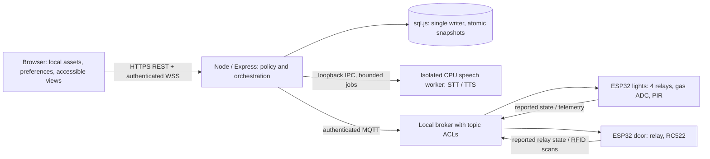
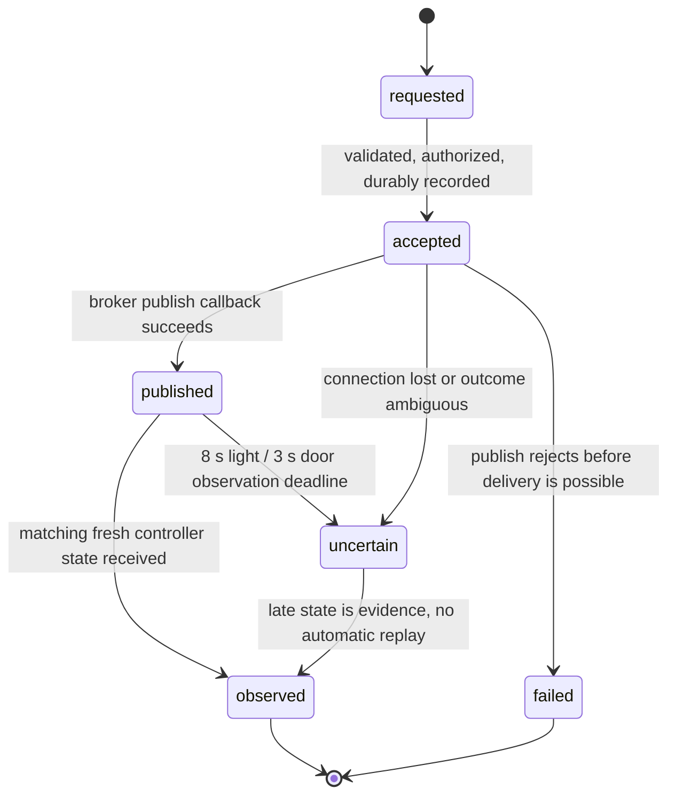

# HomeAuto — implementation architecture, revision 3

Status: **PLANNED**, 2026-11-05. Current behavior is documented in [context.md](context.md); wire formats in [API_CONTRACTS.md](API_CONTRACTS.md); work order in [TASKS.md](TASKS.md). This specification authorizes no production changes in the planning session.

## 1. Boundaries and deployment

Keep Node/Express, CommonJS backend, vanilla browser JavaScript, MQTT, two ESP32s and sql.js. No framework rewrite, cloud inference or mandatory LLM. One household per server; authenticated local owner/resident/viewer accounts are new work. The local copy at `D:\homeauto-main` has no `.git`; the older docs' remote commit is historical provenance, not a verified local HEAD.



Runtime needs LAN connectivity, a running hub and broker, not WAN. HTTPS on the trusted local hostname is the resident entry point; HTTP becomes loopback development only or redirect-only. A certificate-warning bypass is not the deployment trust strategy. Install a local CA/certificate on clients during setup and verify microphone access on each target browser. Broker configuration and service supervision are deployment deliverables, currently absent. CPU worker must have no network inference, no broker credentials and no public listening port. A Node-managed child process with length-delimited JSON/binary stdin/stdout is preferred; an existing native runtime can be wrapped by a long-lived worker. Never interpolate transcripts into shell commands.

### Target structure (new paths are proposals)

```text
public/css/{tokens,base,components,pages}.css
public/js/app.js                    bootstrap and History API navigation
public/js/{state,theme,preferences,i18n,api,components,rooms,security,settings}.js
public/js/{devices,logs,websocket,voice}.js   refactor existing controllers
public/js/audio-processor.js        capture/resampling, no execution authority
public/assets/{icons,fonts,rooms}/   optional, local and licensed
server/server.js                    composition root; no auto-start when imported
server/{app,lifecycle}.js           injectable app creation / startup-shutdown
server/auth/{sessions,policy}.js
server/services/{commands,observations,cards,rooms,aliases,alerts,activity,settings,models,assistant}.js
server/routes/{auth,rooms,alerts,system,assistant}.js  plus existing routes
server/mqtt/mqttClient.js           validated protocol adapter, no optimistic writes
server/db/{database,migrations}.js
server/voice/{voiceEngine,voiceHandler,commandParser,speechWorker,tts}.js
server/tests/{unit,integration}/; public/tests/; tests/hardware/  planned
```

Retain plain script globals initially, with one namespaced object per module as in `Devices`/`Voice`; use dependency parameters for testable services. Load explicit scripts with `defer` in dependency order, or deliberately migrate the whole shell to native ES modules as one task. Do not mix undeclared module globals with `type=module`. Use two-space indentation, semicolons, camelCase, existing snake_case DB/wire fields. JSDoc/interface pseudocode is sufficient; no TypeScript build required.

## 2. Authority, freshness and command lifecycle

Separate four facts: browser↔hub connection, hub↔broker connection, board liveness, device observation. A persisted `is_online=1` is never startup evidence. On hub start/reconnect establish a new epoch, mark old observations stale, then wait for fresh non-retained messages. A retained board `true` or retained relay status is only last known information. Inspect MQTT packet `retain`, validate topic ownership and payload before updating liveness. Mark a board offline immediately on LWT `false` or broker disconnect; otherwise after 60 seconds without a validated live message, checked at most every 5 seconds (planned refinement of current 15-second check). An ordinary status is current only while board live and observation age ≤65 seconds. Gas must also have telemetry age ≤10 seconds. Use a monotonic timer for deadlines and UTC receive times for history.

PIR publishes **changes only**, never an initial clear state. Board heartbeat cannot establish current PIR state. Preserve last motion event with its time; on first boot show “No reading yet”; after 65 seconds without a motion report show “Last movement/clear report …” and unknown current state. Do not manufacture fresh “No movement” by refreshing the board heartbeat. Periodic PIR snapshot is a separately tested firmware improvement, not an existing capability.

The door firmware `denied` status represents an access event, not lock position; keep previous lock observation, record denial separately. Missing or unknown values never map to locked/off/clear/normal. No hardware contact sensor exists: `locked`/`unlocked` means controller-reported relay mode, **not physical bolt/door confirmation**. Detail copy must disclose this; Home must not promise “Home protected.”



These timeouts are initial design settings, not measured latency. Door is shorter because the source auto-relocks after ~5 seconds when its loop runs. A delayed `locked` heartbeat cannot prove an earlier unlock happened. Store a late observation separately if it cannot be correlated. `observed` is weak correlation: existing payloads have no command IDs, sequence numbers or timestamps. One pending command per device globally, no competing manual/voice/RFID actions; an unrelated matching state can still appear. For every result expose `evidence=controller_report`, `correlation=temporal`, `physical_verified=false`; never claim exactly-once execution. A future versioned firmware protocol can add IDs, expiration and deduplication without changing legacy topics by accident.

Persist a command before publish. HTTP `202` means accepted for processing, not executed. Async callback marks broker-published; never update `devices.status` here. Only the observation service updates reported state. Reject new conflicting actions with `409 DEVICE_BUSY`. Convert light toggle to explicit on/off only with a fresh known state; reject door toggle. On restart unresolved records become `uncertain`, never replay. On broker failure no offline queue and no replay of unlock; MQTT clean connection and `queueQoSZero:false`, `retain:false`, bounded outgoing delivery. Use QoS 0 for legacy door unlock/deny (avoid broker resend of timed actions), QoS 1 for explicit idempotent lights and lock with application retry disabled. This is an intentional transport-policy change; verify it in HA-009. Even QoS 0 cannot guarantee delivery/expiry; a timed/ID protocol is needed for stronger guarantees. Do not retry unlock automatically at any layer.

If a recent fresh observation already matches an explicit light/lock request and no pending action exists, return a completed no-op record with `already_reported=true`, without publication. An unlock request always requires explicit action and step-up; do not infer a new five-second interval from an existing unlocked observation.

Bulk lights off is four individual commands with per-device status; at most two concurrently. Target every online supported light whose state is on or unknown (explicit off is safe); offline devices produce skipped/unavailable rows. Never state all lights off if any state remains unknown. No scene engine is introduced.

## 3. Data model and migration plan

Keep existing tables/columns and IDs. SQLite types below are design contracts; migrations run under one process lock and `PRAGMA foreign_keys=ON`. Use integer booleans with checks and prepared statements. Back up/export the existing DB before migration, validate backup read-only, run ordered transactional migrations and advance `PRAGMA user_version` only after successful durable snapshot. Failure must leave recoverable pre-migration data; no reseeding over errors.

| Migration | Additions and constraints | Backfill / recovery |
|---|---|---|
| M01 identity | `users(id TEXT PK, username TEXT UNIQUE, display_name TEXT, password_hash TEXT, role TEXT CHECK owner/resident/viewer, can_unlock INTEGER DEFAULT 0, disabled INTEGER DEFAULT 0, created_at TEXT)`; `sessions(token_hash TEXT PK,user_id FK,csrf_hash TEXT,created_at,expires_at,last_active_at,reauth_at)` | No default passwords. Owner creation via local console setup; tokens hashed; no credential in docs. |
| M02 observations/commands | add `devices.version INTEGER DEFAULT 1`; `device_observations(device_id TEXT PK FK,reported_status TEXT,received_at TEXT,epoch TEXT,source TEXT,retained INTEGER,version INTEGER)`; `commands(id TEXT PK,device_id FK,actor_id TEXT,source TEXT,action TEXT,state TEXT,idempotency_key TEXT,request_hash TEXT,requested_at TEXT,deadline_at TEXT,published_at TEXT,observed_at TEXT,error_code TEXT,evidence TEXT,correlation TEXT,already_reported INTEGER DEFAULT 0)`; UNIQUE(actor_id, idempotency_key); `unlock_challenges(token_hash TEXT PK,session_hash TEXT FK,device_id TEXT FK,action TEXT,expires_at TEXT,consumed_at TEXT)` | Existing device statuses imported as stale, `source=legacy_db`, not fabricated observation times. Old commands not inferred from logs. Challenges are hashed, expire after30s and are consumed in the command-acceptance transaction. |
| M03 rooms/preferences | `rooms(id TEXT PK,name TEXT,name_key TEXT UNIQUE,sort_order INTEGER,cover_key TEXT NULL,version INTEGER DEFAULT 1)`; `devices.room_id TEXT FK`; `device_aliases(alias TEXT,language TEXT,device_id FK,confirmed INTEGER DEFAULT 0,UNIQUE(alias,language))`; `room_aliases(alias TEXT,language TEXT,room_id FK,confirmed INTEGER DEFAULT 0,UNIQUE(alias,language))`; `home_settings(key TEXT PK,value_json TEXT,version INTEGER)`; `user_preferences(user_id TEXT PK FK,value_json TEXT,version INTEGER)`; `idempotency_records(scope TEXT,actor_id TEXT,key TEXT,request_hash TEXT,response_json TEXT,expires_at TEXT,PRIMARY KEY(scope,actor_id,key))` for non-command creates | Room 1→`room-1`, Room 2→`room-2`, Entrance→`entrance`, Kitchen→`kitchen`, Hallway→`hallway`. Preserve displayed names and location compatibility. Unknown locations get deterministic migration IDs; don't guess Living Room. name_key is normalized/case-folded for uniqueness; aliases need explicit owner confirmation. |
| M04 alerts/audit | `alerts(id TEXT PK,device_id FK,kind TEXT,severity TEXT,state TEXT,opened_at TEXT,last_seen_at TEXT,resolved_at TEXT,details_json TEXT,version INTEGER)`; `alert_receipts(alert_id FK,user_id FK,read_at TEXT,acknowledged_at TEXT,PRIMARY KEY(alert_id,user_id))`; `sensor_latest(device_id TEXT PK FK,payload_json TEXT,received_at TEXT)`; add nullable `actor_id TEXT,command_id TEXT,source TEXT` to `activity_log`; add `rfid_cards.version INTEGER DEFAULT 1` | Preserve all 44 observed historical rows. No synthetic active alert from stale normal state. Old events remain immutable; redact UID in resident DTO. |
| M05 model registry | `model_assets(id TEXT PK,provider TEXT,version TEXT,language_json TEXT,path_key TEXT,sha256 TEXT,bytes INTEGER,license_ref TEXT,verified_at TEXT,enabled INTEGER)` | Registry references operator-provisioned assets only; no arbitrary upload/path API. Runtime readability and load probe required for ready. |

All new times are ISO 8601 UTC; adapt existing SQLite `YYYY-MM-DD HH:mm:ss` explicitly as UTC at DTO boundary. Do not append Z to an already-offset timestamp. Home settings default `home_name="My home"`; editable 1–60 characters. Room name 1–60, device 1–80, owner label 1–80, all Unicode NFC, trimmed, no controls. No emoji ban or ASCII-only names. MQTT identifiers fixed in a capability registry from `ESP_BOARDS`; editable type/ID is not supported. Room aliases migrate the source's **actual** bedroom→room 1 and living room→room 2 mapping as provisional aliases; owner must confirm before voice resolves them. A room renamed to collide with an alias raises `409`, never silently controls the wrong group.

### Durable sql.js operation

Current `execute()` synchronously writes the complete DB on every mutation; an extra timer writes every ten seconds. Retain sql.js first, but introduce one serialized transaction queue, export to a same-directory temp file, flush/close, atomic replacement with backup, and error recovery tested on Windows. Never claim a disk write succeeded before completion. On write failure block security mutations and grants, emit persistent diagnostics; ordinary state can remain volatile and explicitly degraded. Enforce one hub writer via lock/ownership check. Simulated power-loss tests and disk-full behavior gate release. Large log volume: gas every two seconds is ~43,200 samples/day before other traffic. Persist latest telemetry with bounded flush (10 seconds), log state transitions/alerts, not every sample; security audit writes durable before grant/publish. Default retention: audit/activity 90 days, command/idempotency 24 hours, inactive alerts 90 days; active alerts retained. Operator backup daily, seven rotating local snapshots; explicit restore with stopped hub, validated file and audit of restore. At-rest encryption is a deployment volume/OS protection prerequisite, not a claim that sql.js encrypts.

## 4. Frontend synchronization and preferences

Single store holds devices, observations, commands, boards, alerts, session, preferences and voice state. REST snapshot plus authenticated WS uses `server_epoch` and monotonically increasing `seq`. Snapshot contains `snapshot_seq`; buffer arriving events, apply only events newer than snapshot, reject older per-entity versions. On gap/epoch change refetch snapshot; do not replay mutations. Reconnect with jitter 1–30 seconds; login expiry closes sockets and stops microphone. Keep one listener registration per module and provide unsubscribe. Route changes dispose page listeners, retain shared store, stop capture, focus H1, preserve back/scroll. Late fetch results cannot overwrite a newer version.

Theme is browser-scoped `homeauto.theme.v1` exactly as approved; 05 default. Accessibility and interface language also local-scoped to survive login/server failure. Favorites, response-language preferences and notification categories are per-user DB preferences mirrored locally only for display. Home/room/device metadata is shared owner-managed data. LocalStorage never grants permissions and holds no session token or raw audio. Persistent keys and conflict rules are in [THEMES.md](THEMES.md). No preference sync changes a locally selected theme.

## 5. Application method catalogue

Every named method here is proposed unless the Reuse column says existing. Inherit these common rules: async operations return Promise; validated DTOs only; thrown `DomainError(code,httpStatus,retryable,fieldErrors?)` is converted centrally; no raw stack/SQL/path leakage. Every row specifies contract, dependencies/effects, failure/security/tests and reuse. Internal helpers without an externally consumed contract may be added within a task; document new public methods here before adopting them.

| Method | Responsibility; inputs → return and validation | Dependencies / side effects | Failures, security and tests | Reuse/refactor |
|---|---|---|---|---|
| `createApp(deps)` | Compose routes with injected DB/broker/auth → Express app; require interfaces | Register middleware/routes; no listeners or DB init | Invalid deps fail fast; integration test import without startup | Extract `startServer` |
| `startRuntime(config)` / `stopRuntime(reason)` | Validated config → runtime handle / void; shutdown once | Acquire DB lock, load workers, listeners; drain writes; close WS/MQTT/timers | Startup failure frees resources; stop never replays commands; HA-002 lifecycle tests | `startServer`, `db.close` |
| `SessionService.login(credentials,context)` | Username/password bounded strings + origin/IP → session DTO/cookie | User lookup, async scrypt verify, durable hashed random session, rate limiter | Generic 401/429; never log password; AUTH tests | New |
| `SessionService.reauthenticate(session,password)` | Active session+password → `{reauth_until}` | Verify credential; rotate session/CSRF and close old sockets | 401/429, CSRF required; no voice/PIN-only bypass | New |
| `authorize(actor,operation,resource)` | Server actor + allowlisted op → void | Pure policy; reads can_unlock/role | 401/403; per-role matrix test, deny default | New |
| `CommandService.request(input,actor)` | Known ID, explicit action, UUID key, source, optional unlock challenge → Command | Policy, observations, repository, broker; durable before publish | 409 busy/key misuse; 503 stale/broker; sensitive challenge; CMD tests | Merge routes/commands, voice executeCommand, RFID grant |
| `CommandService.observe(event)` | Validated live observation → changed Command or null | Correlate one in-flight ID, persist transition, emit WS | Retained/old/denied cannot complete; no physical verification; CMD-02/03 | `handleStatusUpdate` |
| `CommandService.expire(now)` | Monotonic deadline → list of uncertain records | Timer, persist and emit; no retry | Restart recovery, deadline boundary; CMD-04 | New |
| `ObservationService.ingest(topic,bytes,packet)` | Exact allowlisted topic/schema ≤512 bytes → normalized observation/event or rejection | Registry, DB, liveness, commands, alerts, WS | Reject malformed/unknown without crash; MQTT tests; no untrusted authority | MQTT message handlers |
| `ObservationService.snapshot(actor)` | Authenticated actor → coherent Snapshot DTO at seq | Read models + role redaction | 401, consistent sequence; SYNC tests | `/ws init`, getDevices/getEspStatus |
| `ObservationService.checkFreshness(now)` | Time → expired entities | Invalidate, fail pending as uncertain, emit versioned deltas | Cannot refresh device state using board heartbeat; PIR tests | `checkEspTimeouts`, `touchEspBoard` |
| `CardService.save(input,actor)` | Normalized 4/7/10-byte UID, label, boolean → Card | Policy, DB transaction+audit | Owner + recent reauth; duplicate 409; security mutation test | `addRfidCard` (stop INSERT OR REPLACE) |
| `CardService.setAuthorized(uid,value,actor)` / `remove(uid,actor)` | Valid UID+boolean → Card / `{success:true}` | Reauth; durable audit and row change | 404; removal idempotent 204 at new route is not used: existing returns 200; ACL tests | get/delete/addRfidCard refactor |
| `CardService.onScan(event)` | Valid live UID from door topic → grant/deny result | DB lookup, dedup cooldown, audit, CommandService for grant | Fail closed if DB/broker unavailable; no UI role bypass; enrollment never auto-authorizes | `handleRfidEvent` |
| `RoomService.save(input,actor)` | Create/update ID/name/cover key/version → Room | Owner; repository; keep `location` compatibility | 409 name/version/alias collision; ROOM tests | metadata route/config rooms |
| `RoomService.assign(deviceId,roomId,version,actor)` | Existing known ID + room/version → Device | Owner; update room_id and legacy location in one transaction | 404/409; no topic change; ROOM-02 | `updateDevice` |
| `AliasService.confirm(alias,language,target,actor)` | Normalized unique phrase, en/hi/mixed and known device/room ID → confirmed alias DTO | Owner through local console workflow; versioned DB transaction and audit, no actuation | Reject collision/unknown target; no auto-confirm from mockup names; INTENT-01/02 | Existing config ROOM_ALIASES, migrated unconfirmed |
| `AlertService.ingest(sensorEvent)` | Valid known sensor observation → Alert or null | Latest telemetry; dedup active episode, log transitions, WS | No repeated alert storm; safe DB failure signal; ALERT tests | `handleSensorData` |
| `AlertService.acknowledge(id,actor)` | Existing alert + resident/owner → Receipt | Per-user receipt+audit | Does not clear sensor danger; idempotent; ALERT-02 | New |
| `ActivityService.list(filters,actor)` | Bounded limit 1–100, cursor, enum category, dates → Page | Prepared DB query; redact UID for non-owner | 400 invalid range/cursor; privacy/sort/dedup tests | `getRecentLogs`, `getLogsByType` |
| `SettingsService.update(scope,input,version,actor)` | Shared home or per-user allowlisted fields → versioned DTO | Owner shared; user own preferences; DB write | 409 version; reject unknown; PREF tests | New |
| `ModelService.list(actor)` / `activate(id,actor)` | Owner, registry ID → readiness list / readiness DTO | Hash+file+worker probe, warm switch at idle, persist active selection | No arbitrary paths/URLs; failed activation keeps previous model; AI-04 | voiceEngine.init |
| `Api.request(path,options)` | Relative allowlisted URL, verb, body, AbortSignal → DTO | Same-origin fetch, cookie, CSRF, 10s abort except long job polling | Distinguish offline/401/409/503; no automatic POST replay; UI tests | Existing fetch calls |
| `State.applySnapshot(snapshot)` / `applyEvent(envelope)` | Schema/epoch/seq/version validation → updated store | Notify subscribers once; buffer/order handling | Gaps trigger read resync; no mutable pending reset; SYNC tests | Devices.setDevices/updateDevice, WS.emit |
| `State.selectDevice(id,now)` / `selectHome(now)` | Known ID/time → display DTO / counts and warnings | Pure registry+observations+pending projection | Unknown safe values; denied event separate; STATE tests | Devices.createCard logic |
| `Router.navigate(path)` / `Router.disposeView()` | Registered path/query → void; unknown→not-found | History, cleanup, focus and scroll; stop mic | Reject external/js URLs; NAV tests | App handlers |
| `Preferences.read()` / `write(patch)` | Allowlisted typed local values → preferences + persistence status | localStorage with try/catch, same-origin storage events | Corrupt/blocked storage fallback; no credentials; PREF tests | New |
| `Theme.apply(id)` | 01/03/04/05 → applied ID | Root dataset + meta theme-color + Preferences | Invalid→05, no network/action; THEME tests | New |
| `I18n.t(key,params)` / `setLanguage(en_or_hi)` | Known local key, text parameters → string / void | Local dictionaries; document lang; rerender labels only | Missing key fallback English + development diagnostic; never HTML; LANG tests | New |
| `DeviceController.requestAction(id,action)` | Capability+current displayed state → Command | Api + store; no status mutation | Inline pending, 401 login, no unlock replay; UI-03 | Devices.sendCommand |
| `Voice.startCapture(options)` / `stopCapture(reason)` | User gesture, installed STT, permission → session / void | Audio devices, worklet, WSS; stop tracks/socket/timers and ignore late results | Idempotent stop, navigation/logout, denied/missing device; AI-01 | Voice.start/stopListening |
| `NotificationController.handle(alert)` | Valid dedup event → void | In-app always; optional browser notification/sound after opt-in | OS/background not guaranteed; never “denied=locked”; ALERT-03 | Notifications listeners |

Speech-specific methods (including intent and synthesis) are exhaustively contracted in [OFFLINE_AI.md](OFFLINE_AI.md). Reusable DOM constructors have contracts in [COMPONENT_SPEC.md](COMPONENT_SPEC.md). No constructor may publish MQTT or mutate device state merely by rendering.

## 6. Operations and observability

Structured bounded logs: UTC, level, event, request_id, command_id, device_id, outcome, duration_ms. Mask UID, omit credentials, audio, full transcripts and session cookies. Security audit records principal and reason, distinct requested/published/reported/uncertain outcomes. Rotate application log at 10 MiB ×5; DB retention above. Worker metrics contain durations and model IDs, no speech content. `/api/system` read-only owner diagnostics includes broker/boards, observation ages, DB persistence status, speech health and version; no file paths/keys. Minimal `/api/health` remains public liveness, never full readiness.

Uncaught startup errors exit nonzero after cleanup. Ongoing speech failures isolate and disable voice, preserving controls. DB durable failure disables unlock/RFID grants and admin writes; reconnect does not clear unresolved critical alerts. Browser background/closed state has no reliable alert-delivery guarantee; physical gas alarm and safe door egress remain independent deployment prerequisites. Broker service and hub have restart supervision, local firewall and backup/restore instructions. See [SECURITY.md](SECURITY.md) for live-use gates.
