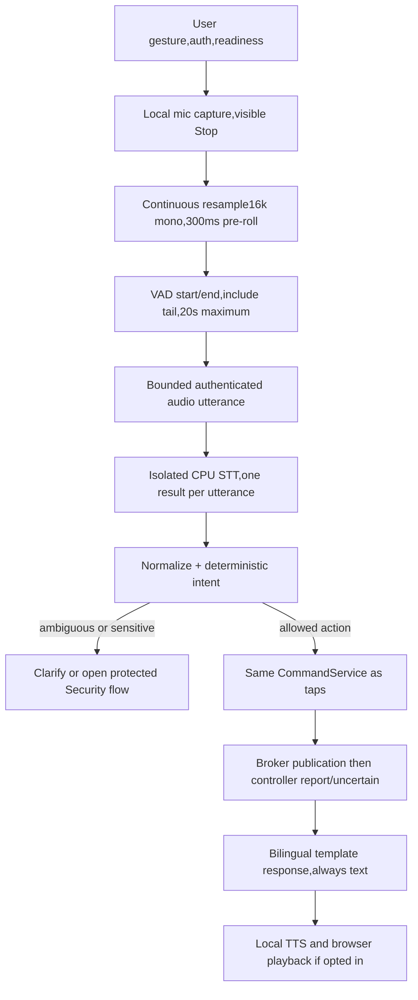

# Shrimaan — CPU-only offline speech architecture

Revision3,2026-11-05. **Architecture selected; model winners pending local measurement.** This document replaces model suggestions in older docs where more specific. No packages installed, models downloaded, inference benchmark run or microphone captured in this planning session. Runtime requirements: no WAN calls for capture, STT, intent, execution, TTS, assets or identity; no Web Speech recognition or reliance on browser speechSynthesis for offline voices. Typed/manual controls remain fully functional without AI.

## 1. What exists and what was verified

Existing Vosk Node adapter creates English+Hindi recognizers per client, feeds16kHz audio, chooses longest partial and executes every final containing a Shrimaan wake variant. English model is **small US English**, not Indian English. Local extracted assets:en70,898,967 bytes, hi82,084,166 bytes, total152,983,133 (~145.9MiB); directory existence is not a successful native load/inference test. Source-side Hindi README has benchmark WER for unrelated corpora, not household accuracy. Installed vosk0.3.39 native bindings may need compatibility work with Node20/Windows; not tested today.

Observed flaws: automatic mic start if permission already granted; no wired manual stop; unbounded client recognizers; both languages can independently execute same utterance; Buffer detection treats text as audio; worklet nearest-neighbor downsampling/no sample continuity can alias; silence dropped after local gate; audio worklet graph output execution needs browser verification; ScriptProcessor deprecated; wake/substrings/negation unsafe; query parser requires action words; optimistic execution; global transcripts/results broadcast; no TTS. Isolated tests found `/voice`400 due to competing upgrade listeners and exact parser faults recorded in context. Fix these before comparing engines so a transport bug does not masquerade as poor STT.

Host inspected:12thGen Intel Core i5-12450H,8 cores/12 logical processors; Node20.19.0, Windows PowerShell environment. Host is a potential benchmark machine, not necessarily deployment target. RAM amount/thermal limits/microphone/browser behavior still need a recorded measurement. No GPU acceleration assumed even if an integrated GPU exists.

## 2. Candidate evidence and recommendation

Sources were checked2026-11-05; pin exact runtime/model revisions+hashes at implementation. Published values below are reference evidence, not local results; MB/MiB and archive/extracted size are explicitly different. Do not compare WER across different test sets as a head-to-head accuracy ranking.

| Candidate | Published storage/memory or benchmark evidence | Suitability / decision |
|---|---|---|
| Existing Vosk small en-us0.15 + small hi0.22 | Official catalog lists40M/42M downloads; small models typically ~300MB runtime each. Hindi reported WER20.89(IITM),24.72(MUCS). Our extracted local pair≈145.9MiB; runtime unmeasured. | Keep regression baseline; one selected-language recognizer initially; parallel decoding only measured and merged once; Hindi/US English do not imply reliable Hinglish. |
| Vosk small en-in0.4 + Hindi | Catalog36M download, WER49.05(NPTEL Pure) for Indian English; different corpus from en-us results. | A low-storage benchmark alternative, not inherently more accurate because labelled Indian English. Existing model needn't be replaced until measured. |
| whisper.cpp multilingual base q5_1 | Publisher lists57MiB quantized asset (base unquantized142MiB); runtime README base estimate~388MB for unquantized configuration. | **First challenger to benchmark**:small storage, one multilingual recognizer; language auto/hi/en modes tested, transcribe not translate. Never use `.en` for Hindi. |
| whisper.cpp multilingual small q5_1 | Publisher181MiB (unquantized466MiB); README small memory~852MB for reference unquantized setup. | Second challenger if base misses target intent accuracy and latency budget permits. No automatic “Small wins” decision. |
| Whisper tiny q5_1 | Publisher31MiB; tiny unquantized memory~273MB reference. | Optional low-resource baseline; promote only if corpus passes. Larger/distilled variants not needed before baseline gate. |

Vosk size/accuracy/memory evidence:[official Vosk catalog](https://alphacephei.com/vosk/models). Quantized asset sizes:[publisher Whisper model list](https://huggingface.co/ggerganov/whisper.cpp). Memory/CPU/quantization estimates:[whisper.cpp README](https://github.com/ggml-org/whisper.cpp). Quantization reduces stored weights; it does not guarantee proportionate RAM reduction or speedup. Decoder buffers, utterance length, worker runtime and simultaneous engines add memory. Benchmark cold and warm end-to-end latency; whisper-bench kernel timing alone cannot measure command turnaround.

| TTS/runtime candidate | Evidence | Product decision |
|---|---|---|
| Piper current OHF engine | Local neural TTS, engine GPL3; embedded espeak-ng phonemization. | Evaluate CPU/startup/packaging with exact voice licensing; engine license and voice/dataset terms are distinct. [Piper upstream](https://github.com/OHF-Voice/piper1-gpl). |
| Piper Hindi pratham-medium + suitable English voice | Hindi ONNX file63.5MB, config~5kB; voice card says hi_IN,22,050Hz and dataset CC-BY-NC-SA4.0. | Candidate for technical audition only until rights/provenance resolved for intended product distribution. Do not assume repository-level MIT covers each voice/dataset. Other Hindi voices require individual cards. [Asset listing](https://huggingface.co/rhasspy/piper-voices/tree/main/hi/hi_IN/pratham/medium),[voice card](https://huggingface.co/rhasspy/piper-voices/blob/main/hi/hi_IN/pratham/medium/MODEL_CARD). |
| Kokoro82M ONNX | Base weights Apache2.0; official voice list includes hf_alpha, hf_beta, hm_omega, hm_psi for Hindi and warns weaker short-utterance/non-English behavior. | **First bilingual TTS audition**, conditional on exact ONNX wrapper supporting Hindi phonemization and installed voices; not selected by parameter count alone. Short home replies must be tested. [Model card](https://huggingface.co/hexgrad/Kokoro-82M),[voice details](https://huggingface.co/hexgrad/Kokoro-82M/blob/main/VOICES.md),[ONNX adapter](https://github.com/thewh1teagle/kokoro-onnx). |
| sherpa-onnx | Runtime supports multiple local speech families; its documented Kokoro multilingual v1.0 integration explicitly adds only English+Chinese. | Useful alternative runtime/packaging, VAD, TTS evaluation; do not equate upstream Hindi weights with Hindi support in a particular wrapper. Verify exact runtime/model pair. [Kokoro integration docs](https://k2-fsa.github.io/sherpa/onnx/tts/pretrained_models/kokoro.html). |

Storage planning arithmetic (an estimate, not an asset manifest):base57MiB+existingVosk146MiB+TTS budget400MiB+VAD/G2P/config budget100MiB≈703MiB. Small181 instead gives≈827MiB. Both can fit a1GiB **model asset** goal if measured TTS package fits; installers, runtime libraries, temp audio and backups are separate. Kokoro82M atfloat32 is about328million raw weight bytes before format/voice/G2P overhead, not a verified ONNX download size. Quantized exports differ. Do not install both base+small+all TTS alternatives in final profile just because individual files fit. Target initial worker peak≤2GiB and total hub≤3GiB on reference machine as **proposed acceptance budgets**, not supported hardware minima; record actual RSS/working set, shared mapped pages and CPU. If target RAM is smaller, rebenchmark or fall back to selected-language Vosk/manual controls.

## 3. Pipeline and resource ownership



Browser owns stream/AudioContext/resampler, server owns utterance/inference/intent, CommandService owns physical dispatch. Use actual audio sampleRate, not getUserMedia requested hint. Streaming resampler must preserve fractional phase across worklet buffers and low-pass before decimation; no separate floor-drop each4096 block. Produce signed16LE16kHz mono,20–100ms frames. Capture pre-roll300ms, endpoint after~700ms silence, min speech200ms, no-speech timeout5s, max20s. Values are initial tunables; measure elderly slow speech/Hindi pauses, not fixed “accuracy” assumptions. Manual Stop has explicit UI meaning:Stop listening ends and processes the current utterance; Cancel discards it before execution. On route/logout/visibility loss use Cancel semantics. Distinguish capture stop from Stop speech playback.

Send final buffered samples+endpoint exactly once; server cap640kB/utterance, odd byte length rejected, frames≤3200 bytes. Continuous audio with final silence allows endpointing, not speech-only chunks that erase pauses. TTS playback never feeds wakeword:single utterance capture ends before playback. Queue max1 active+1 pending globally; per-session1 active utterance. Return busy rather than CPU exhaustion. Worker uses bounded threads (start4 on this host, benchmark2/4/6), leave headroom for MQTT/sensor handling. Cancel queued jobs; long native inference may require worker termination+restart, never block Node request loop. Worker crash resets readiness, not household controls. Memory/tmp audio removed on result/cancel/60sTTL. No recordings by default, debug recording requires explicit per-session opt-in and local deletion policy before enabling it.

## 4. Deterministic bilingual intent contract

```ts
type Intent = {
 kind:'control'|'query'; action:'on'|'off'|'lock'|'unlock'|'query';
 device_ids:string[]; language:'en'|'hi'|'mixed';
 target_source:'explicit_device'|'explicit_room'|'explicit_all';
 sensitive:boolean; normalized_text:string;
};
type IntentResult = {ok:true,intent:Intent} |
 {ok:false,reason:'ambiguous'|'negated'|'unsupported'|'unknown_target'|'conflicting',choices:string[]};
```

Normalize Unicode NFC, case Latin, Devanagari digits toASCII, punctuation/whitespace carefully; preserve Hindi letters/matras. Token/phrase boundaries, not includes(`on`) inside unrelated words. Resolve longest device/room aliases before action, then match action phrases **within capability**:band/बंद on light→off; on door→lock; kholo/खोलो door→unlock, not arbitrary light. Recognize negation “don't/do not/not/mat/मत/नहीं” and conflicting actions as reject/clarify, not remove negation and proceed. Queries identify interrogatives/status independently of action words. Device number must exist; unsupported99 rejected. Bare “turn on light” clarifies target; explicit “all lights” selects only4 lights. Alias ambiguity/no confirmed household alias asks user. No “default all lights”, unknown device type substitution or door inference from action alone. Group queries support only current devices and preserve freshness/calibration limitations.

Hinglish examples for unit corpus, not claims of recognition: “Room1 ki light band karo”→off light1/2;“कमरा१ की बत्ती चालू करो”→on light1/2;“sab lights off”→4lights;“darwaza mat kholo”→reject negated;“gas sensor ka status kya hai”→query sensor-gas;“light99 on”→unknown;“turn on bedroom lights”→only confirmed alias room1;“खोलो”→clarify target. Typed/voice unlock returns sensitive intent then UI link, never MQTT. Read-only sensor queries available viewer; all controls rechecked after parsing, not just at initial voice session.

One utterance produces at most one final intent execution; deduplicate by(user, utteranceID, idempotency key). If multiple recognizers are benchmarked, compare candidates before execution, not execute both finals. “Longest transcript” is not confidence. Whisper token scores/Vosk word confidences are not interchangeable probabilities; use calibrated rejection/grammar/target checks, not an invented common0.8 threshold. Never execute partial transcript, STT prompt text or unconstrained LLM output. Local LLM adds storage/RAM/latency without necessity for7 devices; exclude from current release. Later conversation requires separate budget and no independent physical authority.

## 5. Speech-specific public methods

All new methods return validated DTOs/typed errors, have bounded inputs, no default raw-audio/transcript logging. Test IDs AI/INTENT in TEST_PLAN. Dependencies and reuse are explicit below.

| Method | Responsibility, inputs→return | Dependencies/effects | Failure/security/tests; reuse |
|---|---|---|---|
| `AudioSegmenter.push(frame,rate)` / `finish(reason)` | Float32 samples+actualHz→PCM frames/end once; rate sane8–192kHz, finite samples | Continuous filter/resampler, VAD, pre-roll, timing; worker messages | Invalid/missing mic, slow speech,44100/48000 continuity; AI-01; refactor audio-processor+Voice downsample |
| `SpeechWorker.transcribe({utterance_id,pcm,language,deadline})` |16kPCM≤640kB, allowlisted lang→`{text,language,timings,model_id}` | One bounded CPU job, local model, resets on cancel | Busy/deadline/crash/no-speech, never executes; AI-02/04; voiceEngine.processAudio |
| `SpeechWorker.cancel(utterance_id)` |Known ownedID→`{cancelled:boolean}` | Remove queued job or terminate safely; free buffers | Already completed safe no-op; no reverseMQTT; AI-01; freeRecognisers |
| `IntentResolver.parse(text,registry,aliases,locale)` |text≤500, canonical registry→IntentResult | Pure matching; no DB/network writes | Negated, ambiguous, unsupported return no publish; INTENT suite; commandParser.parseCommand |
| `AssistantService.interpret(input,actor)` |typed/finaltranscript→server intentID+expiry or clarification | Resolver, current registry, session-bound in-memory30s intent store | R, redact reply, worker timing errors; INTENT; voiceHandler parsing |
| `AssistantService.execute(intent_id,key,actor)` |server-stored intentID+UUID→query answer or Command[] | Policy+freshness+CommandService; consume intent idempotently | Reject stale/modifiedID, voice unlock UI-only; CMD/AI-05; voiceHandler.executeCommand |
| `ResponseComposer.compose(result,language,deviceLabels)` |trusted query/command outcome→`{message_key,params,text,language}` | Pure bilingual templates | No physical success inference; stale/calibration qualifiers; LANG-02; new |
| `TtsService.synthesize(message,voice,rate,actor)` |trusted localizedtext≤500, installedvoice, rate.8–1.2→jobID | Worker/localphonemizer, generatedaudioTTL60s | Unsupportedlanguage, license-not-ready, busy; no SSML/shell; AI-03/04; new |
| `Voice.playResponse(audio_url)` / `stopPlayback()` |same-origin authenticated generatedURL→void | Audio element, objectURL cleanup, ownsession | Autoplay blocked→Replay button, text persists; AI-03; new |
| `ModelService.probe(asset_id)` |registeredID→readiness+bytes/modelversion | Hash/read+load/unload/local sample probe; no download | Bad manifest/asset/crash→unready, not “installed=ready”; AI-04; voiceEngine.init |

## 6. Hindi/English output and privacy

Interface language en/hi independent from speech input auto/en/hi and reply auto/en/hi. Auto reply follows detected dominant utterance language; Hinglish follows interface language if uncertain; never switch user preference based on a single STT label. Hindi templates use Devanagari; English room names pronounced via owner-approved phonetic aliases, not cloud transliteration. Test Hindi matras, numbers, room names and proper names. Do not feed romanized Hindi into an English voice and call Hindi supported. If selected language voice unavailable, use text+plain setup notice; no silent cloud/other-language substitute.

Example outcomes:reported light off English “The controller reports Room1 lights off.” Hindi “कंट्रोलर के अनुसार कमरा1 की लाइटें बंद हैं।” Uncertain Hindi “बदलाव की पुष्टि नहीं हुई। कृपया स्थिति जाँचें।” For door say controller report and physical position caveat on first use/detail; avoid long spoken warnings on every routine light change. Product translation needs native-speaker review before release. Never say sensor PPM calibrated or no gas present. TTS failure doesn't change command outcome.

Browser audio travels over encrypted LAN to home hub for local computation;“local” does not mean all inference happens on phone. Raw audio in transient buffers only, not audit. Minimal intent/command audit records actor, device, action, outcome, not raw transcript. Per-user current conversation cleared onlogout/reload/manualClear. Debug corpus collected only with informed permission, kept outside servedpublic paths and excluded from Git, hash/manifest metadata references anonymous speakerID. Existing console transcript logging must be removed in HA-006.

## 7. Benchmark and fallback gate

Create a consented local corpus of at least240 utterances:60Hindi,60IndianEnglish,60Hinglish,60 negatives/ambiguity/background/noise/unsupported targets. At least6 speakers if available, including2 older adults; document if population unavailable instead of claiming representative accuracy. Speaker-disjoint holdout; do not tune aliases/rejection thresholds on the holdout. Quiet/noisy(fan/TV at recorded conditions), near/far mic, slow/soft speech, paired turn on/off, negation, UID-administration phrases and dangerous unlock attempts. Safety/control tests use simulator; no voice unlock actuation.

Record per engine/build/modelhash/threads/CPU/RAM/OS/power profile:installed/extracted bytes, cold load, warm transcribe p50/p95, end-of-speech→intent p50/p95, real-time factor, peak process working set, CPU utilization, idle usage, full action-controller-report→firstTTSaudio, word/character error, exact intent+target accuracy, wrong-action count, reject/clarification rate, duplicates, false speech from silence, and TTS native-speaker intelligibility. Keep raw per-item results and numerator/denominator, not just a flattering average. Separate STT transcription from deterministic parser accuracy and controller network latency.

**Proposed selection gates, not measured:**zero dangerous/negated/unknown-target executions and zero duplicate actions in suite;≥95% exact intent+target on supported quiet commands in each language group,≥90% under selected household noise with safe rejection allowed and reported separately; warm end-of-speech→intent p95≤2.5s reference CPU, localTTSfirstaudio p95≤1s, hub p95lightcommand pipeline responsiveness unaffected during inference. Rejection doesn't count as a correct completed command. If none passes, do not lower safety gate:keep selected-language Vosk/manual/text, offer explicit language selection, improve corpus/audio, or document latency tradeoff for user review. Hinglish remains labelled limited until it passes.

Fallback order:chosen validated localSTT→explicitly configured existing localVosk(if appropriate language)→typed+manual. No automatic dual-engine rerun can execute twice. ChosenTTS→text-only; no cloud. Worker unavailable→homecontrols continue. Model assets licensed, verified, preprovisioned before WAN-disconnect test; disable package-manager/model auto-download and test reboot with WAN blocked. No precise CPU/accuracy claims may be promoted from upstream corpus numbers to HomeAuto performance.
