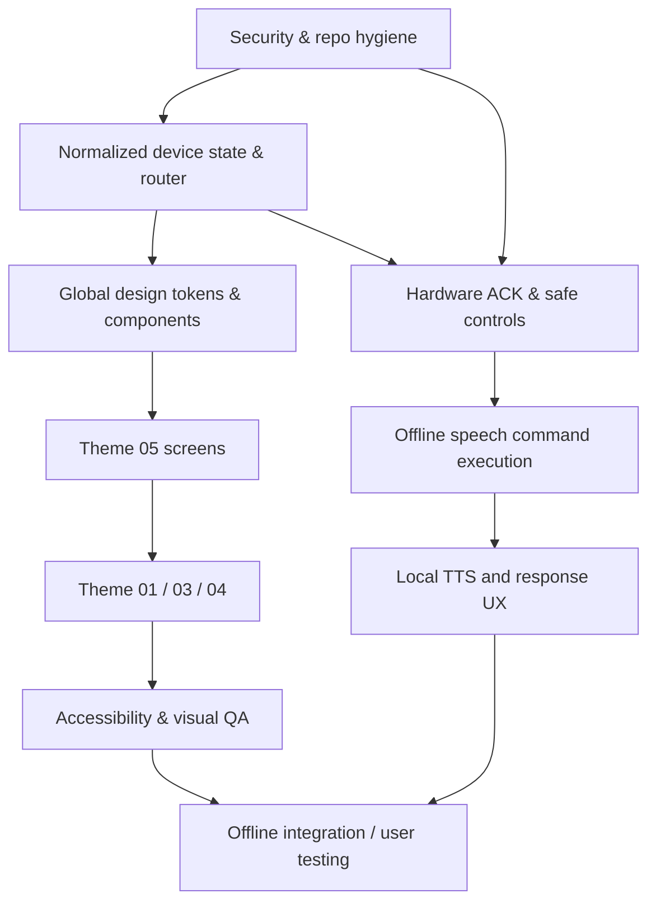

# HomeAuto — Implementation Plan and Delivery Checklist

> **Active implementation roadmap revision3,2026-11-05.** Canonical coding tracker is [TASKS.md](TASKS.md); start[HANDOFF_TO_GPT6.md](HANDOFF_TO_GPT6.md). The original roadmap/tickets below are retained as historical rationale,**not a second active backlog**. Their phase numbers, ticket meanings, pinned remote SHA and old coding prompt are superseded by this block and current handoff. No production coding was performed during planning.

## Active dependency-ordered phases

Each phase inherits precise module/method/wire contracts from [ARCHITECTURE.md](ARCHITECTURE.md) and [API_CONTRACTS.md](API_CONTRACTS.md). Source paths below are targets, not files already implemented. Completion requires the referenced TASKS acceptance and TEST_PLAN evidence; specification prose alone is not implementation completion.

| Phase / goal | Prerequisites and tasks | Files / reusable elements / interfaces | Risks and meaningful tests | Done / next dependency |
|---|---|---|---|---|
| 0 Discover and isolate baseline | HA-001complete; HA-002pending | server/server.js→app/lifecycle, test harness; all source inventory; createApp, startRuntime | Existing startup connects live MQTT/seedsDB; testimport must have zero sideeffects;19 syntax checks not integrationproof | Injectable isolated baseline and known regression fixtures; enables1 |
| 1 Security, safety and reliability foundations | 0; HA-003..011 | db migrations/atomic queue; auth/session/policy; routes+singleWSupgrader; safeDOM; Command/Observation/Card/Alertservices; MQTT config; supervised firmware safety | Authbypass, XSS, falseack, stalePIR, deniedstate, brokeautorelock, diskloss; AUTH/SEC/CMD/MQTT/DB/SENSOR | Protected simulatedcontrol and durablestate; real-use gate additionallyHA-010hardware. UI can proceed in isolation; enables2/3 |
| 2 Shared design system + themes | HA-006; HA-012/013 | tokens/base/components CSS, theme bootstrap/preferences, originalSVG, DOMcomponents; Theme.apply | Contrast/storagefailure/keyboard/unknownswitch semantics; COMP/THEME | All4palettes,05fallback, accessible reusable states/localassets; enables3 |
| 3 Responsive shell, state and bilingual foundation | HA-005/008/013; HA-014..016 | state/api/router/app/websocket, i18n, login/shell; Snapshot/envelope contracts | Races/doublelisteners/micprivacy/English-onlycriticalcopy; SYNC/NAV/AUTH/LANG |5routes+secondaryrouting, authenticateddata, safeen/hi labels; enables4 |
| 4 Home, Rooms and actual device interfaces | HA-017..020 after schema/state/grammar prerequisites | M03 rooms/preferences, rooms/devices/Homecontrollers, RoomCard/DeviceCard/SummaryCard; room/device/preferences APIs | Silentroommapping, fakecapabilities, bulkpartialsuccess; ROOM/PREF/UI/CMD |7IDsusable, IDs/topicsstable, pendinghonest, actualfavorites/summary; enables5 |
| 5 Security, RFID and sensors | HA-021..023 after control/observation foundations | singleDoorDetail/confirmation, cardmanager, SensorDetail; unlockchallenge/cards APIs | Authwronglayer, UIDreplace, physicalclaim, uncalibratedgas; SEC/SENSOR/CMD | Completeprotected flows with simulator; supervised hardware still releasegate; enables6 |
| 6 Activity, alerts, notifications, settings | HA-024..028 after M04/state/shell | activity/alerts/settings/advancedviews, ActivityList/SettingsRow; activity/alertreceipts/system APIs | Auditpagination/dedup, ackclearingdanger, secretsindiagnostics; ACT/ALERT/OPS | All required secondary settings functional, all4themechoices; enables7/8 |
| 7 Offline speech and TTS | HA-029..035; centralcommand+en/hi+aliases+shell | commandParser, assistant APIs, voicecapture/worker/tts, M05registry; SpeechWorker/Intent/Response/Ttscontracts | Falseunlock/duplicatefinals/latency/licensing/nativebindings; INTENT/AI/PRIV | Measured CPUprofile, localHindi/Englishspeech and textfallback; noWAN; enables8/9 |
| 8 Accessibility, offline packaging, resilience, user trials | HA-036..039 after screens+speech | trustedHTTPS/manifest/localassets/optionalSW, backup/operator docs, visual/accessibility fixtures | Closedbrowseralertassumptions, staleAPIcache, atomicwritefailure, seniorconfusion; OFFLINE/DB/COMP/THEME/LANG | ColdWAN0startup,100primarytheme-widthcombinations+criticalstates, keyboard/Hindi/older-userissuesresolved; enables9 |
| 9 Automated and physical validation | HA-040..042; softwaregates+HA-010safe fixture | isolated integration test broker+explicit manual hardware protocol, fixtures, evidence | Testsaccidentallyactuatehome; modelmetricsinvented; HW/AI/SECregressions | All meaningful suitespass; physicalrelay/door/RFID/networkpowerfailresults recorded separately; enables10 |
| 10 Release readiness and polish | HA-043/044; all blocking tasks complete | docs/taskledger/operatorpackage/version/review | Skippedhardwaregate hiddenbyvisualpolish; secrets/packageprovenance | Repeatablelocalreleasewithhonestlimits, all4themesandcontrols, backup/trustsetup; noautomaticpush/deploy |

### Active task grouping and stop conditions

Implement one task or coherent dependency group; updateTASKS with changed paths and actual evidence after each. Don't install/download/flash as a side effect of planning. Coding setup may install dependencies only as necessary for its authorized task; model provisioning and hardware actuation require explicit scope/operator involvement. Missing broker/hardware doesn't block mock/injected software work, does block real-use claims. No live deployment until security and door failsafe gates pass. Every phase must preserve the current7IDs and exact legacyMQTTtopics while declared reliability/security changes are tested.

Detailed tests[TEST_PLAN.md](TEST_PLAN.md), decisions[DECISIONS.md](DECISIONS.md), visual contracts[THEMES.md](THEMES.md),[SCREENS.md](SCREENS.md), speech[OFFLINE_AI.md](OFFLINE_AI.md), safety[SECURITY.md](SECURITY.md). The current coding model is GPT-6 Soul High; old model references below describe the prior pack only.

## Historical roadmap and previous guidance (superseded where specified above)

> **Execution handoff v2.0** · Written for GPT-6.1 High (Sol), but model-independent. This is a repository implementation plan, **not** a claim that any new frontend or offline AI model is already implemented.

> **Scope:** HomeAuto resident-first frontend redesign + selectable themes + safe preservation of existing IoT behavior + staged offline Shrimaan voice integration.  
> **Default design:** Theme 05 Serene Emerald. **Options:** Theme 01, 03, 04.  
> **Source:** https://github.com/Mishrajishri/homeauto (`main`, inspected commit `08e1b2013375fa794175dd7a6d462fdd0c536c89`).  
> **Read first:** `context.md` for current implementation, `design.md` for UI/control details, `reference-images/` for conceptual visual references.


## GPT-6.1 High (Sol) — direct implementation handoff (copy/paste into your coding session)

> You are implementing **HomeAuto**, a consumer-friendly, offline-first smart-home UI using the EXISTING repository, not drawing unrelated concept websites. Read `context.md`, `design.md`, `plan.md`, and view the four images in `reference-images/` **before editing**. The repository at `https://github.com/Mishrajishri/homeauto` was inspected at `main` commit `08e1b2013375fa794175dd7a6d462fdd0c536c89`; check your actual working tree and preserve newer work. Build the **five-page responsive application** with theme **05 as default**, and selectable themes **01/03/04**; use only hardware that exists in code. Keep the existing Node/Express/MQTT/ESP32/SQLite architecture, refactor incrementally, and do not break commands or WebSocket updates. No cloud assets or browser Web Speech API. Treat the voice-model swap/TTS as a later benchmarked phase, not a fake initial integration. Every interactive control must have real behavior, a correctly labeled planned state, or be hidden. Door/RFID access security, real hardware acknowledgement and HTML injection are P0/P1 concerns. Work in small verified batches, record actual test results, never report untested operations as successful. Do not ask for permission for routine implementation decisions already settled in these documents. Ask only for an indispensable secret, physical setup parameter, or potentially hazardous action that requires the user's involvement. At the end of each batch report exact files changed, functionality working, tests run, remaining blockers, and the next batch.

### Required reading and execution order

1. `context.md` = **baseline and safety truth**; never silently reclassify PLANNED hardware as implemented.
2. `reference-images/` = **inspiration only**; derive reusable UI styles rather than screenshot clones.
3. `design.md` = **design system, route/component/interaction contract**.
4. This `plan.md` = **work sequence and acceptance gates**.
5. Actual repository files + tests = **operational authority**; report drift if different.

### Nonnegotiable output standard for GPT-6.1 High

- Produce **working source changes**, not a screen full of inline mock data or a single unmaintainable HTML file.
- Reuse existing server data and messages. If a new API is needed, implement and test it; do not call imaginary endpoints.
- Use existing vanilla-JS architecture unless migration is explicitly requested. A model's ability to write React or TypeScript is *not* a reason to rebuild the working stack.
- Provide screenshots taken from the rendered working UI when browser tooling permits, at least mobile and desktop; if tooling unavailable, state the limitation and verify via DOM/CSS/code tests.
- Handle the **normal**, **loading**, **empty**, **offline**, **error**, **pending**, **access-denied**, and **sensor-alert** states for every relevant screen.
- No invented device states, security assurances, uncalibrated PPM guarantees, camera streams, background microphone recording, or cloud fallbacks.
- There is no requirement to use a particular proprietary UI generator, visual coding assistant, or model API. Make the artifact runnable in the user's local environment.

## 0. Objective and non-negotiable boundaries

Build **HomeAuto**, an approachable local smart-home app, that a person unfamiliar with computers can learn in a few seconds. Apply a consistent visual system to Home, Rooms, Security, Assistant and Settings. Maintain real light, door, gas, motion, RFID, logging, and connectivity functions. Add four selectable UI themes (05 default, plus 01/03/04), support offline local operation, and prepare an audio pipeline for CPU-only Hindi/English/Hinglish recognition and offline speech output.

**Prohibited shortcuts**

- Do not show mockup-only cameras, AC, music playback, fans, curtains, water heating, climate, family members, scenes, multi-door systems or security arm modes as real, working features without backend/hardware support.
- Do not trade physical-device security for appearance. Existing unauthenticated unlock and published private key are P0 issues.
- Do not replace local speech with Google Web Speech API or other network-based speech tools.
- Do not add Google Fonts/CDN icon/photo dependencies; everything needed at runtime must be locally served.
- Do not replace MQTT/ESP32 protocol or database schema incidentally during frontend work.
- Do not claim “action completed” until the ESP32 reports the state (or label pending/timeout honestly).
- Do not infer that the present Vosk implementation is already Whisper/TTS-ready; validate changes with tests.

## 1. Success criteria, measured in user behavior

A release is acceptable when:

1. A nontechnical user can find a light and change it from the Home or Rooms screen, with unmistakable On/Off and failure feedback.
2. A user can see Front Door Locked/Unlocked/Unavailable at a glance; unlock is protected and never triggers accidentally.
3. A user can reach gas/motion status and RFID access management in at most a few clear taps.
4. The app works in a LAN **with internet disconnected**; no runtime network calls are made to outside domains.
5. First-time browsers use **Theme 05**, and all four themes may be switched without page reload; the chosen theme survives refresh/restart.
6. All essential actions are reachable with 48px+ targets and understandable labels. Easy Mode is comfortable with 18–20px base text.
7. No layout overflows at 320–430px mobile and 1024–1440px desktop widths.
8. Screen reader, keyboard focus, reduced motion, Hindi text, and error states are usable.
9. The app still functions when the AI model is disabled or missing.
10. Device state, UI copy, and voice acknowledgement correspond to confirmed hardware outcomes, not only sent commands.

## 2. Locked design and page decisions

| Area | Decision |
|---|---|
| Product name | **HomeAuto** |
| Offline assistant | **Shrimaan** |
| Selected themes | **01 Warm Organic**, **03 Universal Comfort**, **04 Friendly Pastel**, **05 Serene Emerald** |
| Default | **05 Serene Emerald** |
| Navigation | Five primary destinations: **Home, Rooms, Security, Assistant, Settings** |
| Activity | Secondary screen under **Security > Activity** |
| Device organization | By room; stable IDs in backend; editable display names |
| Default appearance | Light, quiet, high-contrast, rounded cards |
| Senior accessibility | Text-only comprehension, large targets, optional Easy Mode on **all** themes |
| Fonts | Locally available Inter or system UI; locally available Devanagari fallback; no CDN |
| Icons | Original house SVG + consistent local SVG icon set |
| Voice | Offline STT/TTS; tap-to-speak first, wake-word opt-in later |
| Deployment | Existing Node/Express backend + local MQTT + ESP32; keep vanilla frontend initially |

## 3. Implementation phases and order

### Phase 0 — Repo hygiene and security foundation (P0, before real household use)

**Actions**

- [ ] Work in a new branch; snapshot current UI, device responses, event payloads and firmware behavior.
- [ ] Add `.gitignore`: `node_modules/`, `server/db/*.db`, local model binaries as appropriate, secrets and generated TLS keys. Stop tracking already committed dependencies and sensitive local artifacts safely.
- [ ] Generate new local TLS private key/certificate and remove the exposed key from active use. Coordinate history cleanup where practical.
- [ ] Protect REST and WebSocket access with an appropriate **local** authentication/authorization approach. Establish an admin/owner role for RFID registration and door unlock. Deny unauthenticated commands.
- [ ] Add validation and reasonable rate limits for command actions, card UIDs, owner names and metadata.
- [ ] Remove unsafe `innerHTML` interpolation of user/server content; render as text and restrict icon markup to trusted static SVG.
- [ ] Define an explicit hardware acknowledgement model; don't set device status optimistically in persistent storage as if it were confirmed.
- [ ] Put a visible “prototype/uncalibrated” note on gas concentration readings until properly calibrated.

**Acceptance:** a second device on the LAN cannot unlock/add RFID cards without authorization; an XSS attempt in owner/device name renders as plain text; a failed MQTT publish or missing hardware ACK does not show success.

### Phase 1 — Normalize data, routes and visual tokens

**Actions**

- [ ] Separate data fetching, WebSocket handling, normalized UI state and visual rendering.
- [ ] Build device presentation adapter from existing `devices` rows + `espBoards` messages. Track `reportedStatus`, `online`, `lastSeen` and `pendingAction` independently.
- [ ] Define room mapping: the current Room 1 / Room 2 plus Entrance, Kitchen, Hallway. Show friendly names where configured, retaining stable device IDs.
- [ ] Add a compact router for Home/Rooms/Security/Assistant/Settings and secondary pages; preserve URLs on refresh.
- [ ] Implement global app shell: top bar, navigation, notification entry, helper text, empty/loading/error states.
- [ ] Create design tokens in CSS (all four palettes) and common components: Button, IconButton, Switch, Chip, StatusLabel, Card, RoomCard, DeviceTile, Toast, Dialog, EmptyState, AlertRow, SettingsRow.
- [ ] Implement locally stored theme setting `homeauto.theme.v1` with hard default `05`.
- [ ] Remove remote Google Fonts references and replace with a local/system font stack.

**Acceptance:** UI skeleton loads with internet unavailable; all routes work on refresh; rendering never relies on a fake demo dataset outside a clearly marked development-only fixture; theme switching updates every screen.

### Phase 2 — Build the five screens (Theme 05 first)

Implement in this order, checking `design.md` for the full component inventory and button rules:

**2A Home**

- [ ] Greeting, household name setting, truthful summary.
- [ ] Four or more high-value tiles from actual hardware: lights, door, gas, motion; Shrimaan shortcut.
- [ ] Quick actions: All lights off, Lock door, Check home, See all devices.
- [ ] Confirm all action states and absence/partial connectivity states.
- [ ] Omit actual camera/AC/fan/music/scene controls until implemented.

**2B Rooms**

- [ ] Room list, filter chips (All/Lights/Sensors/Door), room detail route.
- [ ] Light control, door detail, sensor details, device list.
- [ ] Friendly room names and simple admin rename workflow; room-add persists only after real data model exists.
- [ ] No dead add buttons: if not yet implemented, hide or label not available.

**2C Security**

- [ ] Status banner driven by real hardware state; lock/unlock actions separated clearly.
- [ ] Secured unlock confirmation and 5-second relock explanation.
- [ ] RFID list, add and revoke, with safe rendering and proper input validation.
- [ ] Gas/motion tiles and security alerts, with no overstated safety claims.
- [ ] Activity view with type/date filters; log display is not delete-history action.

**2D Assistant**

- [ ] New accessible single-utterance **Tap to speak** experience.
- [ ] Permission/recording/processing/speaking/error/no-model states.
- [ ] User transcript, response message, text command fallback and suggestion chips.
- [ ] Stop/pause listening and data/privacy disclosure.
- [ ] Keep existing Vosk functional while integrating new offline model in a later phase; do not block other pages on voice readiness.

**2E Settings**

- [ ] Appearance page: four theme swatches; 05 default; reset to default.
- [ ] Accessibility page: Large text, reduced motion, clearer contrast; persist choices.
- [ ] Devices/Rooms, Notifications, Voice & Assistant, Privacy, Help, About.
- [ ] Advanced diagnostics: only here show local server, MQTT, ESP32-A/B, local AI installation and storage states.
- [ ] Hide/honestly mark Family Members and Automations until they exist.

**Acceptance:** all five pages are navigable and functional on mobile and desktop with confirmed backend data; every control has a defined action; no marketing-board decorative element is mistaken for a feature.

### Phase 3 — Derive and QA all four themes

**Actions**

- [ ] Use Theme 05 as the stable base component geometry.
- [ ] Implement Theme 01 warmer backgrounds/photos and evergreen buttons (same behavior).
- [ ] Implement Theme 03 more accessible density, prominent safety banner and larger default typography/touch areas.
- [ ] Implement Theme 04 cooler/pastel categories and blue mic treatment; do not sacrifice contrast.
- [ ] Verify semantic danger/online/locked colors are consistent and legible in every theme.
- [ ] Create one accurate app-produced screenshot per theme of each major screen and compare with respective reference image *qualitatively*.
- [ ] Test theme switch while command is pending, while scrolling, across refresh and with large-text setting.

**Acceptance:** 4 themes × 5 core pages are visually coherent; navigation placement, critical alerts and action meaning remain consistent. Default new browser always starts on 05.

### Phase 4 — Offline speech-to-text and text-to-speech

This phase is a separate, measurable subsystem: **offline CPU performance is a constraint, not a guaranteed model outcome**.

**Step 4A: Baseline / benchmarking**

- [ ] Record CPU model, RAM, OS, microphone quality, tested command set and approximate model storage budget (goal about 1 GB combined STT/TTS model files, to be validated).
- [ ] Test current Vosk Hindi + English pipeline as baseline.
- [ ] Benchmark multilingual `whisper.cpp` quantized base/small with Indian-accent English, Hindi and Hinglish, 1–5-second and longer utterances, noise and elderly speakers.
- [ ] Measure time-to-transcript, word error patterns, missed wake/command rates, memory and CPU use. Select model with acceptable latency, not simply best accuracy.

**Step 4B: Harden speech pipeline**

- [ ] Fix audio WebSocket text/binary framing; use explicit binary flag rather than Buffer type alone.
- [ ] Implement proper utterance endpointing/VAD, sample-rate conversion and silence segments for speech decoding.
- [ ] Add opt-in mic permission and visible stop button; **tap-to-speak is default**.
- [ ] Add safe command parsing for lights/doors/sensors; prevent substring false positives and dangerous ambiguous commands.
- [ ] Validate command target and authorization before MQTT publish.

**Step 4C: Local replies**

- [ ] Evaluate local TTS candidates such as Kokoro ONNX or Piper, but only adopt a voice verified for Hindi/English and correct licensing.
- [ ] Use TTS only after a trusted action result is known; always show text feedback in parallel.
- [ ] Bundle local voice model files and fonts; avoid all runtime external web requests.
- [ ] Add configurable reply language / speech rate after bilingual quality is tested.

**Step 4D: Optional conversational reasoning**

- [ ] Keep deterministic intent engine as primary safety control; evaluate a small local LLM only for harmless general queries or paraphrasing.
- [ ] Do **not** allow free-form LLM output to directly publish MQTT or unlock doors. Convert only to validated allow-listed intents.

**Acceptance:** run a full speech->device->speech demo in a disconnected WAN environment, CPU only; show honest pending states and confirmed result. Disabled AI must never prevent manual operation.

### Phase 5 — Offline packaging, PWA and reliability

- [ ] Make frontend assets (fonts if any, icons, HTML/CSS/JS, approved images) fully local.
- [ ] Finish a proper PWA manifest with valid locally generated icons. Consider service worker only with a deliberate versioned cache strategy; don't cache API command responses as if they were current device state.
- [ ] Document LAN-without-WAN setup: router or hotspot, MQTT broker, static local hostname/IP, secure HTTPS, device discovery or manual config.
- [ ] Ensure server launch can report absent broker/model/ESP32 without crashing the dashboard.
- [ ] Add clear reconnection, stale-state, low-memory, model-unavailable, and no-microphone states.
- [ ] Create tests for device command, door auth, RFID create/revoke, WebSocket reconnect, sensor alerts, theme persistence, voice fallback and offline network behavior.
- [ ] Add an accessible offline help view explaining routine operations and privacy.

**Acceptance:** app starts and works without WAN; no console/network external requests; closing/reopening preserves preferences; offline voice failure degrades to manual controls.

### Phase 6 — Real household user testing and polish

Run structured, moderated tests with at least one nontechnical adult and—where possible—one older person, **without explaining the controls in advance**. Ask them to perform these tasks:

1. Find which lights are on; turn one light off.
2. Check if the front door is locked.
3. Find the last door access event.
4. Find whether the gas or motion sensor has an alert.
5. Speak one Hindi and one English request, or use typed fallback.
6. Change from default Serene Emerald to another theme and back.
7. Turn on Large text / Easy Mode.
8. Identify why an offline light cannot be controlled.

Record task completion, mistaken taps, time spent searching, wording misunderstandings, screen-reader issues, and support requests. Revise based on observed difficulty, not abstract aesthetics.

## 4. Dependency map



**Parallelizable:** core icon/components, accessibility, and voice benchmarking can progress independently once source contracts are frozen. Do not integrate insecure unlock flows into the redesigned UI merely because a frontend card is finished.

## 5. Deliverable file map

| Output / path | What must exist |
|---|---|
| `context.md` | Existing repo facts, architecture, features, constraints, security boundaries |
| `design.md` | Themes, palette tokens, typography, UX component specs, every page/CTA behavior |
| `plan.md` | Ordered tasks, acceptance gates, test matrix and constraints |
| `reference-images/theme-01-warm-organic.png` | Exact earlier generated option 1 visual board |
| `reference-images/theme-03-accessible-family.png` | Exact earlier generated option 3 visual board |
| `reference-images/theme-04-pastel-blue.png` | Exact earlier generated option 4 visual board |
| `reference-images/theme-05-serene-emerald-default.png` | Exact earlier generated option 5 visual board (default) |

These Markdown files and reference images are **documentation outputs only**. They do not imply the GitHub repository was updated or that a runnable redesigned UI exists already.

## 6. Suggested implementation PR / commit batches

| Batch | Primary files / modules | Test gate |
|---|---|---|
| A. Safety | server routes, TLS config, auth, sanitization, MQTT command handler | Unauthorized unlock blocked; XSS escaped; ACK reflected |
| B. Foundation | `public/index.html`, tokens/base CSS, router/state/theme JS | 5 routes, theme persistence, no CDN |
| C. Home & Rooms | reusable card components, rooms grouping, current `devices.js` integration | 7 real devices + responsive controls |
| D. Security | RFID and activity screens, protected door actions | registration/revocation, event filters, confirmation |
| E. Assistant | mic UI and existing voice flow | manual fallback, stop control, state clarity |
| F. Four themes | tokens and appearance/accessibility preferences | 4×5 screenshot/contrast QA |
| G. Local AI | offline STT, command parser validation, TTS | CPU-only, no-WAN task tests |
| H. QA/packaging | tests, local assets, help, PWA if ready | happy path + edge conditions + actual user tests |

## 7. Test matrix for the implementing engineer

| Area | Test cases | Expected result |
|---|---|---|
| Theme default | Clear local storage, reopen | Theme `05` |
| Theme selection | Choose 01/03/04 and refresh | Selected theme remains |
| Theme reliability | Switch during pending light command | State stays correct |
| Network WAN | Disconnect internet but retain LAN | App and device control still work |
| LAN disconnect | Stop local server | Clear reconnect banner; no false success |
| ESP offline | Power down ESP32-A | Light/sensor status unavailable; no operating toggle |
| MQTT publish | Broker offline | Command fails clearly without state change |
| ACK timeout | Suppress device status after command | Pending -> unknown/error, not success |
| RFID unauthorized | Scan unknown UID | Denied event, never unlock |
| REST authorization | Unauthenticated unlock POST | Blocked |
| HTML injection | Insert `` in device/owner name | Shows literal safe text, never executes |
| Unlock safety | Tap unlock | Auth + confirmation + physically reported result |
| Gas alert | Simulate validated event | Distinct warning, no certified-PPM claim |
| Microphone denied | Deny browser permission | Manual/tap UI remains usable |
| Voice models missing | Remove/disable model | No crash, clear setup help |
| Hindi code switch | “Shrimaan room ki light band karo” | Correct target/action or request clarification |
| TTS offline | WAN removed | Local voice response works after verified setup |
| Keyboard | Tab through all primary buttons | Visible focus and functional keyboard controls |
| Screen reader | VoiceOver/NVDA on controls | Clear button/state labels |
| Large text | Enable 200% zoom / Easy Mode | No overlapping actions or clipped Hindi |
| Motion settings | Enable reduced-motion | No looping mic pulse required to convey recording |
| Narrow width | 320px portrait | No horizontal overflow, touch navigation intact |
| Desktop | 1440px | Sidebar, centered content, no enormous stretched controls |

## 8. Risks, mitigation and release blockers

| Risk | Severity | Required response |
|---|---|---|
| Public TLS private key, no auth, unauthenticated door unlock | **P0** | Rotate/remove keys and implement local access control before live home testing |
| MQ-xx ADC linear conversion misrepresented as accurate gas PPM | **P0 for safety claims** | Remove certified language, calibrate properly, keep dedicated safety alarms |
| Optimistic DB status after MQTT publish | **P1** | Separate pending/confirmed, add ACK handling/timeout |
| Model too slow on CPU | **P1** | Benchmark base/small quantized options; fallback to fast deterministic controls |
| Hindi-English code switching errors | **P1** | Evaluate real phrases/accents; correction/clarification UI |
| No externally hosted assets under offline requirement | **P1** | Bundle or fall back to system assets, inspect network calls |
| UI promises unsupported devices/actions | **P1** | Hide future features, feature flags, honest empty states |
| Too many settings or tiny controls for older users | **P1** | Easy Mode, user testing, large targets and simple language |
| Font glyph issues in Hindi | **P2** | Devanagari-capable local/system stack and rendering QA |
| Theme inconsistency between routes | **P2** | Central tokens, visual comparison matrix and screenshot tests |
| Current Git repo includes vendor dependencies/models | **P2** | Ignore tracked runtime artifacts appropriately; documented install instructions |

## 9. Definition of Done by user scenario

### Scenario A — Simple light control

- [ ] Home shows the real lights count/status.
- [ ] Open Rooms, choose Room 1 (or friendly name), see proper light cards.
- [ ] Tap Turn off; show “Turning off…”.
- [ ] If firmware reports off, show “Off”; if not, show meaningful error.
- [ ] UI updates in every connected browser without refresh.

### Scenario B — Safe door access

- [ ] Security shows **Locked**, **Unlocked**, or **Unavailable** based on actual report.
- [ ] Unlock requires appropriate authorized session and confirmation.
- [ ] After unlock confirmed, show clear auto-relock state and count only if trustworthy.
- [ ] RFID added/revoked by authorized owner is logged; unknown card is denied.

### Scenario C — Offline Shrimaan

- [ ] With no WAN, speak a tested Hindi/English phrase using local mic processing.
- [ ] See transcript; command goes through validated parser and safety gate.
- [ ] Hear locally generated spoken result (if TTS installed) after confirmation.
- [ ] If models fail, typed commands/manual control remain available.

### Scenario D — Four genuinely functional themes

- [ ] First install loads 05.
- [ ] Settings > Appearance offers exactly 05/01/03/04 with clear swatches.
- [ ] 03 uses larger, clearer defaults; accessibility toggle works for all themes.
- [ ] Switching theme changes design only, not state/data permissions/device behavior.

## 10. Short checklist for GPT-6.1 High (Sol) / Codex

1. Read `context.md`, then `design.md`, then this plan, then inspect the actual GitHub working tree.
2. Build a repository map and run tests (if present). Identify present code versus planned features from context.
3. Fix the P0 security blockers or isolate the redesign from any reachable real door-control service while prototyping.
4. Implement **Theme 05 + five-page shell** first. Match its **calm hierarchy** but keep cards tied to real seven-device data.
5. Wire up room-filtered real controls, RFID/security/activity and offline error handling.
6. Add 01/03/04 using shared tokens—do **not** fork four separate apps.
7. Benchmark offline speech/CPU and integrate only verified local components; do not assume image concepts are implemented features.
8. Capture real screenshots, compare, fix accessibility and mobile/desktop edge cases; produce a concise changelog of actual working functionality.

**Final principle:** HomeAuto must be simpler to operate as it becomes more capable. A senior resident should never need to understand MQTT, Vosk/Whisper, JSON, ESP32, or a database to turn off a light or check whether the front door is locked.


---

## 11. Work breakdown structure — atomically verifiable tickets

Use the sequence below. A ticket is only **done** after changed paths and verification evidence are recorded. Avoid bundling unrelated security changes with visual redesigns in a single unreviewable commit.

| Ticket | Outcome and concrete deliverable | Depends on | Verification |
|---|---|---|---|
| HA-001 | Inventory current pages, routes, CSS, event schema, firmware status topics. | None | File map and baseline screenshots or limitation noted |
| HA-002 | Create feature inventory `current / planned / hidden`; compare with docs. | HA-001 | No planned device accidentally active |
| HA-003 | Fix tracked private key exposure; generate new key locally and ignore secret paths. | HA-001 | No new private key in tracked files |
| HA-004 | Protect REST API, `/ws`, `/voice` appropriately, with approved local login and role policy. | HA-001 | Unauthenticated mutation/door action rejected |
| HA-005 | Replace unsafe DOM interpolation and validate user labels. | HA-001 | Injection strings display only as text |
| HA-006 | Add command action allowlist and owner-only RFID mutation. | HA-004 | Invalid type/action and privilege tests pass |
| HA-007 | Implement pending/confirmed/failed command status model; keep DB reported state authoritative. | HA-006 | Missing status ACK cannot yield 'success' |
| HA-008 | Normalize online/freshness per ESP/device; detect stale and disconnected. | HA-007 | Offline messages disable affected actions |
| HA-009 | Introduce app shell routes and navigation accessibility; preserve REST/WS. | HA-001 | Five routes direct-load/reload correctly |
| HA-010 | Ship design tokens and four complete theme palettes. | HA-009 | Theme tokens apply consistently to all components |
| HA-011 | Add persistent theme 05 default + settings selector. | HA-010 | Unset/invalid choice falls back to 05 |
| HA-012 | Build reusable cards, buttons, chips, badges, dialogs, forms and toasts. | HA-010 | Interactions keyboard and touch usable |
| HA-013 | Build Home from real 7-device data with simple status copy. | HA-008, HA-012 | Real counts, never mockup-only device tiles |
| HA-014 | Build Rooms list, filters and current room details. | HA-008, HA-012 | Device list grouped from actual locations |
| HA-015 | Add safe device rename/delete and room display labels. | HA-014, HA-004 | IDs and MQTT topics never change on rename |
| HA-016 | Build Security with confirmed door, gas and PIR states. | HA-008, HA-012 | Unavailable != locked; experimental gas disclaimer |
| HA-017 | Build RFID manager, protected add/revoke and scan history. | HA-004, HA-016 | Authorized role, validation and confirmation |
| HA-018 | Build activity feed with category/date filters and honest empty state. | HA-012 | No fake entries and no destructive 'clear' ambiguity |
| HA-019 | Build Shrimaan assistant UI, tap-to-speak and typed fallback. | HA-012 | Mic stops and text works if model unavailable |
| HA-020 | Build Settings, appearance, accessibility, notifications, help, diagnostics. | HA-011, HA-012 | Rows navigate or explain nonavailability |
| HA-021 | Tune four themes as distinctly styled variants with same content. | HA-013..020 | Screenshot/contrast matrix for all routes |
| HA-022 | Remove third-party runtime dependencies; local assets and icons. | HA-009 | No external request on a disconnected WAN |
| HA-023 | Define STT adapter, segmentation, transcripts and audio lifecycle. | HA-019 | Buffer vs control WS handling tested |
| HA-024 | CPU benchmark offline multilingual recognition alternatives. | HA-023 | Recorded timings/size/accuracy; no guessed numbers |
| HA-025 | Local TTS adapter + Hindi/English voice fallback. | HA-024 | Spoken response with WAN disabled |
| HA-026 | Confirmed-result speech and safe command grammar. | HA-007, HA-025 | Voice doesn't falsely announce door unlock |
| HA-027 | Offline install/backup/restore guidance and packaging. | HA-022, HA-026 | Fresh-machine offline runtime smoke test |
| HA-028 | Senior/nontechnical usability pass, keyboard/reader/mobile QA. | HA-021, HA-027 | Test evidence and issues resolved |

## 12. Definition of screen completion (apply independently to each of five pages)

Every page MUST have:

1. A semantic page heading and exactly one clear page purpose; no visually overwhelming telemetry.
2. A usable mobile layout at 320, 360, 390 and 430 px, tablet ~768 px, and desktop 1024/1440 px.
3. Correct navigation state and browser-back behavior, including direct route reload.
4. Real data bindings/zero-state placeholders with honest language; never an unexplained sample value.
5. Appropriate empty/loading/network-unavailable/error/pending/alert treatments.
6. At least a standard 48×48 CSS px interactive target for primary controls; larger in Easy Mode.
7. Keyboard Tab/Shift+Tab/Enter/Space/Esc semantics, visible focus, live status messages when necessary.
8. Accessible labels, contrast and no color-only distinctions; test English and Hindi glyph rendering.
9. Theme 05 plus 01/03/04 visual QA and reduced-motion support.
10. No failing/external calls when the WAN is off and the local server is reachable.

| Screen | Operational must-haves | Explicitly not required in UI MVP |
|---|---|---|
| Home | Actual devices and status; shortcuts to existing controls; alert navigation. | Cameras, temperature, fake scenes, user profile cloud. |
| Rooms | Existing locations, filters, device details and safe toggles. | Magic discovery/pairing, automatic room photos, AC/fan controls. |
| Security | Door state, confirmation, owner auth, RFID, motion/gas, activity. | Formal burglar-alarm arming modes, reliable gas PPM certification. |
| Assistant | Tap-to-speak state and consent, typed command, phrase suggestions, results. | Always-on mic default, local conversational LLM from day one. |
| Settings | All four themes, accessibility and privacy, diagnostics, local help. | Fake member accounts, cloud sync, unavailable automations. |

## 13. Interaction acceptance — Given / When / Then

### HA-AC01: First load and theme selection

- **Given** a new browser with no stored preference, **when** Home loads, **then** Theme 05 is visibly active, all routes share its tokens, and no unexpected microphone session begins.
- **Given** user selects Theme 04, **when** navigating Home → Rooms → Security → Assistant → Settings and reloading, **then** 04 remains selected everywhere.
- **Given** `homeauto.theme.v1` has an invalid value, **when** app initializes, **then** apply 05 without crashing.
- **Given** large text enabled, **when** changing themes, **then** large text stays enabled independently.

### HA-AC02: Real light and slow acknowledgement

- **Given** `light-1` is online and reported OFF, **when** user taps Turn on, **then** the UI displays pending without asserting ON yet.
- **Given** the controller reports `home/light/1/status=on`, **when** broadcast arrives, **then** state reads On and pending ends.
- **Given** the acknowledgement never arrives or controller goes offline, **when** timeout occurs, **then** show a retryable uncertain result, preserve last confirmed state, and do not claim success.

### HA-AC03: Door/RFID authorization

- **Given** unauthenticated or viewer session, **when** unlock/RFID-mutation API is invoked, **then** it must be rejected server-side regardless of UI.
- **Given** authorized user selects Unlock, **when** confirmation appears, **then** it explicitly names the door and approx. 5-second firmware auto-relock behavior.
- **Given** user cancels, **when** dialog closes, **then** no MQTT unlock command is published.
- **Given** owner revokes a card, **when** action completes, **then** it disappears/updates in real list and audit event is recorded.

### HA-AC04: Offline local voice

- **Given** all model files preinstalled and internet disconnected, **when** user taps mic and speaks a tested Hindi or Indian-accent English light command, **then** transcription, parsed intent, verified device response and local TTS occur without public network calls.
- **Given** assistant cannot confidently determine a device, **when** user speaks ambiguous request, **then** it asks for clarification and does not send a door/relay command.
- **Given** mic permission is denied or model absent, **when** Assistant opens, **then** a plain-language explanation and typed control remain available.

### HA-AC05: Accessibility and truthful states

- **Given** a gas reading has not been calibrated, **when** sensor details open, **then** they never present the number as certified concentration.
- **Given** any essential device is offline, **when** Home summary renders, **then** it must say some devices are unavailable, not “Everything safe”.
- **Given** user has reduced-motion enabled, **when** Assistant listens, **then** textual “Listening” and icon state remain clear without animation.

## 14. Engineering decisions when implementation options conflict

1. **Safety before shortcuts:** a button must never bypass auth, send unknown actions, or speak unverified success.
2. **Real behavior before fidelity:** the mockup may show devices not present; reduce the card count and retain spacious hierarchy instead of manufacturing data.
3. **Reuse before rewrite:** existing Express, SQLite, MQTT and WebSocket logic are the baseline; choose incremental adapters.
4. **Small useful commits:** one tested user journey per batch, rather than multiple pages that don't work.
5. **Local first:** one-time provisioning may require a network, but runtime must not reach outside the home LAN.
6. **Readable CSS/JS before visual effects:** the model can implement pure CSS shapes, SVG icons, transitions and local illustrations; no 3D dependency is necessary.
7. **No fixed latency promises:** model choice depends on real CPU and accent tests, not on download size alone.
8. **Don't silently overwrite:** retain useful existing functionality and report behavior changes. If a physical device isn't available, use an explicitly labeled safe simulator only for tests, never disguise it as verified hardware.

## 15. Test harness and reporting expectations

**Existing scripts observed:** `server/package.json` contains `npm start` and `npm run dev` (run from `server/`). Do not assume a preexisting `npm test` command. If adding tests, add their scripts and documentation. Ensure the local MQTT broker is separately running when doing hardware integration tests. Never automatically alter physical outputs during CI.

**Recommended new automated tests:**

- Pure JS unit tests for theme persistence, device DTO normalization, status freshness, room grouping, user-friendly labels, command allowlist and phrase parsing.
- HTTP integration tests for public read access policy (as chosen), authenticated command authorization, RFID owner-only mutation, invalid action rejection, log filtering and security headers.
- WebSocket integration tests for `init`, `device_update`, `esp_status`, `sensor_data`, `alert`, voice binary/control distinction and reconnect behavior.
- UI tests for keyboard, large text, tab state and all four themes. When possible, record mobile/desktop screenshots into a clearly named local QA directory.
- Controlled MQTT simulator tests with a **test broker** and fake topics/devices, never run destructive door commands against live hardware without a human present and authorization.

**Report format for each batch:**

```text
Batch / ticket IDs:
Repository SHA or working tree status:
Files created / changed:
Features implemented (actually working):
Features intentionally hidden / deferred:
Security and privacy impact:
Tests run and exact outcomes:
UI screenshots / routes tested:
Known limitations / next tickets:
```

## 16. Theme × page × responsive evidence matrix

When the implementing agent finishes visual work, it should check these 20 combinations, not just take a single beautiful homepage screenshot:

| Theme | Home | Rooms | Security | Assistant | Settings |
|---|---|---|---|---|---|
| 01 Warm Organic | ☐ | ☐ | ☐ | ☐ | ☐ |
| 03 Universal Comfort | ☐ | ☐ | ☐ | ☐ | ☐ |
| 04 Friendly Pastel | ☐ | ☐ | ☐ | ☐ | ☐ |
| **05 Serene Emerald (default)** | ☐ | ☐ | ☐ | ☐ | ☐ |

For each combination test normal/alert/offline as relevant, touch target sizing, typography, selected tab/active button styling, errors, and navigation. Check mobile small/standard, desktop, keyboard, zoom, and Hindi script at least once per theme.

## 17. Context-window / session continuity protocol

Before pausing a long GPT-6.1 High coding session, write a compact, *verifiable* handoff note in the development chat or existing project notes:

```text
Checked source SHA:
Completed tickets:
Files modified and reason:
New endpoints/events (exact):
Current test status:
Secrets / security considerations (no actual credentials):
Last UI route/theme verified:
Open risks:
Next exact action:
```

On resumption: reread the three docs, compare the actual working tree/diff, and use the handoff note only as evidence to recheck. Never assume an old assistant's “done” means code is present.

## 18. Release gates (no scope hiding)

- **Gate A — Demo UI:** five pages, 4 themes, local data, clear planned/hide boundaries. It is safe only as a **read-only** demonstration if live security auth/ACK is incomplete.
- **Gate B — Safe local control:** protected access, validated actions, real device acknowledgements, no exposed runtime keys, XSS mitigation, alerts and connection truth. Only now is it suitable for supervised home-control tests.
- **Gate C — Offline voice:** tested STT/intent/TTS on actual CPU with no WAN, consent and privacy controls, never spoken false success.
- **Gate D — Household-ready candidate:** accessibility QA, backup/recovery, real-device reliability tests, family user trials and security review. No medical/life-safety promises.

**Stop condition:** if P0 physical-access risks remain, do not describe the application as safe for an unattended real household, regardless of appearance or AI quality.
