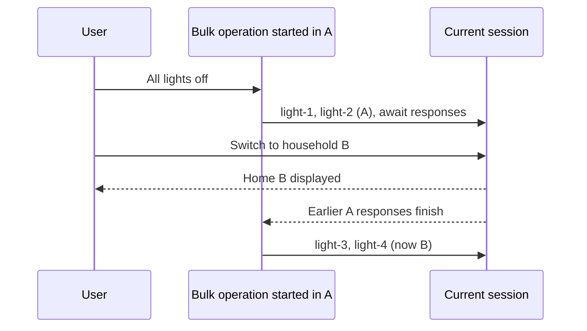

# HomeAuto state-machine audit2 — 2026-11-14

## Result and scope

Four new actionable findings were reproduced in the current frontend: one P1 involving household ownership and three P2 findings involving command cleanup, voice cancellation and assistant response ownership. Six deterministic counterexample traces exercise the actual source with mocked effects; the household batch issue was also reproduced through the actual browser UI. These are open findings, not fixes.

The rebuilt UI/UX is preserved. All28 hashes in `D:/homeauto-audit-tools/stageshow-20261114/uiux-final-20261114/sha256.json` matched at audit entry. No application, styles, firmware, MQTT configuration, database schema, authentication policy or production infrastructure was changed during this audit. Only this report and the development checkpoint are written in the project. Test artifacts remain outside it.

This continues [the first inventory](STATE_MACHINE_AUDIT.md), rather than replacing its historical snapshot. That inventory contains87 workflow families:29 browser,31 server/database,3 optional catalog,8 firmware,8 operational and8 older/unwired families, plus3 derived projections. The reconstruction adds U30, document departure/restoration:88 logical families now recorded. Counts describe workflow families, including mixed/explicit encodings; they are not counts of flags or a proof of every possible program state.

The second pass concentrates on cross-machine transitions, cancellation, stale callbacks and ownership. Runtime backend/firmware paths were confirmed unchanged against baseline `5e0a040fef9025c85847193cc39f326f43ec8c11`; selected server invariants were inspected and77 tests were rerun. This is not a repeat full-system production acceptance or an exhaustive model checker.

## Earlier findings: current status

| Earlier item | Current status | Evidence |
|---|---|---|
| A1: failed demo exit leaves stale controls on real transport | Addressed for the tested real/demo transition. The transition retires controls, blocks non-auth mutations and restores the simulated model on non-auth failure. Commands require a current session. This does not cover all household/batch interleavings below. | `main.js:30`, `main.js:77`; `api.js:20`; existing actual-source regression passed. |
| A2: preference busy lock survives realm change | Addressed for the tested preference path. `preferenceOperation` owns cleanup and the demo switch resets its owner. | `main.js:38`; existing actual-source regression passed. |
| UI rebuild's departing-document reads | The `pageLeaving` guard remains present in refresh/render/update; beforeunload/pagehide mark departure and pageshow resumes. Its coordinator regression passed. | `main.js:24`, `main.js:206`, `main.js:353`; prior two-engine browser evidence is in `docs/ux/STAGESHOW_REBUILD.md`. |

The4 existing frontend coordinator/transport regressions passed within this audit's77-test run. This confirms their specific invariants; it does not invalidate the new counterexamples.

## Findings

### SM2-01 — P1: a bulk light operation can cross into another household

Current source: [main.js:37](D:/homeauto-main/public/js/main.js:37), household switching at [main.js:29](D:/homeauto-main/public/js/main.js:29), chooser at [views.js:222](D:/homeauto-main/public/js/views.js:222).

`bulkOff` captures the starting devices but sends them in batches of two. It does not capture or recheck their household/realm. `switchHome` rotates the session and clears pending controls but does not cancel an already running bulk loop or use the shared `transitioning`/`mutationsPaused` path. After the first batch resumes, the remaining calls use the new session and transport.

Browser reproduction, using the real frontend with every API route mocked:

1. Open Home A and select **All lights off**; hold the first two HTTP responses.
2. Navigate through Settings → Home details and select Home B.
3. Wait until Home B is displayed, then release the Home A responses.
4. Observe requests for `light-3` and `light-4` under Home B's selected session.

Recorded request sequence: `A/light-1`, `A/light-2`, **`B/light-3`, `B/light-4`**. There were0 page errors,0 external requests and0 physical actions. The browser fixture did not use a live cloud account, real cookies or hardware. The test establishes client behavior under the modeled session contract, not a production actuation.

This requires an account able to switch between homes. The schema deliberately scopes device IDs by household, so the same IDs can exist in both. Backend membership, role, freshness and remote-control gates still apply; remote lights normally default off. This is incorrect action scope for an authorized multi-home user, not a demonstrated tenant-authorization bypass.

An additional VM trace covers failed hydration: server selects B → B snapshot fails → `state.session` is B, `state.snapshot` is null, no transition view retired the old DOM. `render` returns early at `main.js:210`; an old retained command callback is not rejected by the coordinator. The visible chooser page itself contains no light controls, so this trace alone is **not** claimed as a directly clickable stale light card. The browser-confirmed continuing batch is the actionable request path.

**Missing invariant:** every action and queued batch belongs to its starting `{user, household, real/demo realm, generation}`. A realm transition must invalidate remaining old work before switching authority.

**Remediation:** use one transition coordinator for household and demo changes; retire old controls before rotation; bind and recheck a realm token before every batch/request. If the server already switched but hydration fails, keep controls unavailable and reconcile the server's actual session. Merely restoring a cached old household locally would be unsafe.

Evidence: `probe-results.json` SM2-01a/b, `browser-household.json`, `browser-household.png` in the evidence directory below.

### SM2-02 — P2: reauthentication can leave a device busy indefinitely

Current source: [main.js:32](D:/homeauto-main/public/js/main.js:32), [main.js:35](D:/homeauto-main/public/js/main.js:35), CSRF/session generation at [api.js:33](D:/homeauto-main/public/js/api.js:33).

A command adds its device to `ctx.pending`, captures `Api.sessionVersion`, then awaits HTTP. A successful reauthentication can rotate CSRF/session generation while the physical home remains the same. The command's `finally` removes its entry only if the version still matches. A late response therefore leaves the device in the pending Set even when its server command is terminal.

The actual-source probe starts a command, increments the session version to model the verified reauth side effect, resolves an `observed` response, and confirms `ctx.pending.has('light-1') === true`. Reauthentication itself was not performed against a live account. Device controls remain unavailable and bulk-off eligibility can remain blocked until another full reset clears the Set.

This is the command path's own cleanup defect, distinct from A2's preference path, which now has an operation owner.

**Missing invariant:** every pending-command owner releases its own lock exactly once, even if its response is too old to update the current view.

**Remediation:** use an operation token keyed by realm/device and release only that token's lock in `finally`, independently of whether its result may commit. Do not let an old completion clear a newer command's lock. Keep authentication revision separate from physical-home identity.

Evidence: SM2-02 in `probe-results.json`.

### SM2-03 — P2: voice cancellation has two incomplete exit paths

Current source: [voice-controller.js:34](D:/homeauto-main/public/js/voice-controller.js:34), handshake close at [voice-controller.js:27](D:/homeauto-main/public/js/voice-controller.js:27).

**Late resume:** `start()` checks its generation after the worklet loads, but not after `await this.context.resume()`. Cancel while resume is pending → tracks stop, context/socket clear, state becomes ready → resume resolves → the old start sets state to listening and creates a20s deadline. The probe confirms `state === 'listening'` while stream and socket are null and the track has stopped. This is a false listening/processing state, **not** evidence of continued microphone recording after Cancel.

Native API ordering was checked rather than assuming the mocked AudioContext behaves like every browser. A second Chromium probe imports the actual VoiceCapture class, uses real AudioContext/AudioWorklet and a synthetic silent MediaStream, mocks signaling, and queues cancellation around the native resume call. It reproduces `state=listening`, null stream/socket and an ended track. This is a controlled asynchronous cancellation, not a recorded human microphone session. The local WebKit build exposes no AudioContext, so no native WebKit audio result is claimed. Promise behavior was cross-checked against the [Web Audio specification](https://www.w3.org/TR/webaudio/#dom-audiocontext-resume) and [Chromium's implementation](https://chromium.googlesource.com/chromium/src/+/HEAD/third_party/blink/renderer/modules/webaudio/audio_context.cc). The bug is the missing ownership check; not every cancellation timing produces it.

**Handshake close:** closing before `voice_ready` clears the5s timer and runs failure cleanup, but does not resolve/reject the `ready` promise. The probe confirms cleanup and0 remaining timers while the `start()` promise is still unsettled. With the socket closed and watchdog removed, no remaining normal path settles that await. This can leave the caller's async busy feedback unfinished.

**Missing invariant:** cancellation/error from every startup stage invalidates subsequent completions, releases capture resources and settles its caller exactly once.

**Remediation:** generation-check after every awaited startup step, including resume. Give the handshake a single resolve/reject/abort owner; close/cancel/error/timeout must all settle it. Preserve track/context cleanup. Do not convert client cancellation into an assumed physical-device cancellation.

Evidence: SM2-03a/b in `probe-results.json` use mocked microphone, socket, audio nodes and timers. `native-voice-cancel.json` adds the real-AudioContext Chromium trace; its media stream and signaling remain synthetic. `native-audio-order.json` records the feature/order check. No actual microphone recording occurred.

### SM2-04 — P2: an old assistant failure can overwrite a newer answer

Current source: [main.js:143](D:/homeauto-main/public/js/main.js:143), contrasted with the success guard at [main.js:132](D:/homeauto-main/public/js/main.js:132).

`executeIntent` checks `assistantGeneration` after a successful execute response. Its catch calls `assistantError` without that check. The actual-source probe holds query1's execute response, completes query2 with `Current reply`, then rejects query1. The old catch replaces the current reply with `CONNECTION_LOST`. The outer `typed` catch cannot prevent this because the inner function consumes the failure.

The same path can repopulate a cleared conversation or display stale failure feedback after a route/realm change. The probe directly confirms newer-answer overwrite; it does not claim an unauthorized backend action.

**Missing invariant:** success, failure and cleanup may affect a conversation only while they own its current generation/realm.

**Remediation:** gate the error path with the same operation identity as the success path. Apply that rule to deferred notifications/audio failures during the eventual remediation. Already dispatched hardware commands must remain visible through their authoritative activity records; deleting a conversation must not pretend to undo them.

Evidence: SM2-04 in `probe-results.json`.

## Current machine ownership and inventory delta

| Family | Current encoding / owner | Audit status |
|---|---|---|
| U05/U06: demo and household realms | `state.session`, snapshot, `realDemoSession`, `Api.demo`, `sessionVersion`, `realmGeneration`, `transitioning`, `switchingHome`, `mutationsPaused` | Demo failure path improved; household/batch coordination is still split. SM2-01. |
| U04/U07: reauth and request revision | Session payload/CSRF revision and per-request captured version | Valid stale-response rejection does not imply correct operation cleanup. SM2-02. |
| U15/U17/U18: preferences, commands and groups | Preference Symbol owner; command Set; sequential two-command batches | Preference owner fixed; command and group ownership remain incomplete. |
| U08/U19: rendering and conversation | Render ID/`aria-busy` versus assistant generation | Render and assistant success guards exist; assistant error commit lacks ownership. SM2-04. |
| U20/U22: voice and playback | Capture generation, stage/state, resources, handshake promise; separate audio generation | Capture cancellation has missing transitions. SM2-03. Playback was inspected but no additional counterexample is promoted here. |
| **U30: document lifecycle** | `active → leaving` on beforeunload/pagehide; `leaving → active` on pageshow; refresh/render/update guards | New since inventory1. Existing coordinator regression passed; prior browser proof is retained in the UI report. |
| S06/S23/S24/S27: local/cloud/gateway/result acknowledgment | Separate durable command records, leases, admission checks and acknowledgment state | Selected safety invariants passed. Do not collapse these into one optimistic device flag. |
| S09/S10: sensor episode and user receipt | Active/resolved episode separate from read/ack timestamps | Acknowledgment does not resolve the hazard; selected regressions passed. |

The first report's remaining server, catalog, firmware, operational and older/unwired families remain part of the inventory. They are not duplicated as new findings. No new QR/pairing-code state machine exists in the source.

## Required transition contracts for remediation

1. **Realm:** ready(real/demo, user, home, generation) → switching → ready or unavailable/reconciliation. Every old operation loses permission to start another side effect once its origin generation changes. Auth rotation alone is a separate dimension.
2. **Operation:** created → pending → completed/failed/cancelled; exactly one owner releases each lock. Discarding a result never skips that owner's cleanup.
3. **Voice:** ready → ticket → microphone → socket/handshake → worklet → audio resume → listening → processing → ready. Cancel/error is a defined exit from every stage; every promise settles, all tracks stop, and a stale callback cannot enter listening.
4. **Conversation:** interpreting/executing → answer/error only for the current conversation/realm token. Clear/navigation/replacement retires both success and error callbacks.
5. **Hardware evidence:** accepted/published/delivered is not observed; observed is not a measured bolt/relay position. Reconnect/retry must not replay an unlock. Existing durable backend protections must survive frontend remediation.

No new framework or state-machine package is required to express these contracts. A shared transition reducer/coordinator and operation tokens can fit the existing ES-module architecture. This is a proposed contract, not implemented code.

## Verification and evidence

Evidence directory: `D:/homeauto-audit-tools/state-machines-v2-20261114`.

| Execution | Actual result |
|---|---|
| `node .../probes.cjs` |6 assertions-based counterexample traces reproduced4 findings. Assertions expect the undesirable current state; this is not a passing product-invariant suite. Source SHA256 values are embedded in `probe-results.json`. |
| `node .../browser-household.cjs` with WebKit2370 |Actual UI reproduced A,A,B,B batching;0 page errors,0 external requests,0 physical actions. All API responses intercepted. Browser screenshot and JSON saved. |
| `node .../native-voice-cancel.cjs` with installed Chromium |Actual VoiceCapture and native Web Audio reproduce SM2-03a under controlled queued cancellation. Synthetic silent media/signaling, ended track, no physical actions; JSON saved. |
| Native audio feature check |Chromium exposes AudioContext; the local WebKit build does not. Initial unsupported-API invocation failed; feature detection was then added and the result recorded. No WebKit native audio pass is claimed. |
| First browser fixture attempt |Failed because the mock omitted `/api/auth/activity`; retained in the audit history, corrected before successful reproduction. This was a fixture error, not an application finding. |
| Filtered existing invariant run |14 tests passed; `invariant-regressions.log`. This narrow selection was followed by the fuller run below. |
| `node --test --test-concurrency=1 server/tests/core.test.js server/tests/online-safety.test.js server/tests/frontend-transitions.test.js` under Node22 |**77/77 passed**,0 failed/skipped; `safety-regressions.log`. This reran local persistence/command/security invariants, cloud delivery/redemption/outage/restart/revocation cases and4 existing frontend regressions. |
| Runtime source comparison |No tracked runtime changes in `api`, backend services/auth/online/cloud/db/MQTT/voice/lifecycle or firmware against baseline. |
| UI checkpoint verification |All28 checkpoint hashes matched at entry. Final check: all22 application/test files unchanged; the only changed checkpoint file is `docs/DEVELOPMENT_STATE.md`, as expected. `ui-preservation.json` records it. |

The server tests use in-memory/temporary repositories and disposable PostgreSQL WASM, mocked publications and loopback transport. They do not test physical devices or a live Neon/Vercel deployment. Existing passing tests do not exercise all newly demonstrated interleavings.

## Prior safety limitation carried forward

The first inventory's F01/F02/F04 coupling remains: blocking Wi-Fi/MQTT recovery precedes timed door relock in the firmware loop and can delay it. This is an existing, unchanged hardware release gate, not a newly counted finding. No firmware was flashed or timing experiment performed. Preserve the supervised door gate and the qualified lock-position warnings.

## Handoff

Recommended order: fix SM2-01's shared realm/batch ownership first; then SM2-02 lock ownership, SM2-03 voice settlement/cancellation, and SM2-04 stale error commits. Convert the six counterexamples into regression expectations and rerun the existing UI/navigation/safety suites during remediation. Keep the visual layer and the saved UI/UX checkpoint intact.

This audit is complete for the stated second-pass scope. The four findings remain open. No fixes, deployment, live credential changes or production operations are claimed.
