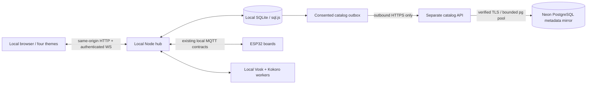
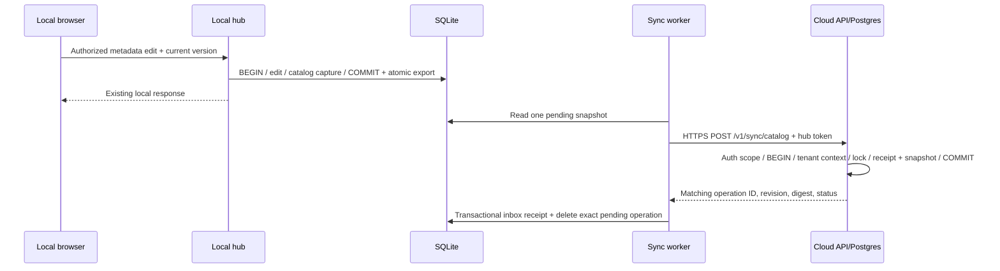

# Backend architecture

Implemented 2026-11-06. This extends the existing Node.js/CommonJS application; it does not replace the frontend, MQTT, identity, speech or local repository.

There is no return arrow from the cloud to a physical command path. The cloud returns acknowledgments, not instructions. The browser continues using the local hub even if the cloud is absent. No router port forwarding, browser database access or cloud login was added.

## Active local modules and boundaries

| Module | Responsibility |
| --- | --- |
| server/server.js, lifecycle.js | Explicit startup/shutdown, loopback by default, LAN TLS gate, repository/services/HTTP/WS/MQTT wiring; five-second state expiry and daily maintenance |
| server/app.js | Same-origin REST, Host/Origin/CSRF checks, permission checks, validation, bounded JSON, static SPA fallback; owner-only system diagnostics |
| server/auth/sessions.js | Local scrypt identities, hashed session tokens, role/reauth checks, idle and absolute expiry |
| server/db/repository.js | Schema-5 synchronous transactions, single writer, atomic exports/backups, local source of truth; optional in-transaction catalog capture |
| server/db/maintenance.js | Seven daily backups; auth/idempotency/command cleanup; 90-day new activity/resolved-alert retention; legacy history preserved |
| server/services/home.js | Sole command owner, safe publish/timeout handling, observations, board freshness, gas/motion alerts, RFID decisions |
| server/mqtt/broker.js | Credentialed broker connection, topic subscriptions, callback fault containment; no queued physical replay |
| server/realtime.js | Authenticated read-only snapshots and actor-owned voice sockets, heartbeat containment and bounded buffers |
| server/services/assistant.js, voice/intent.js | Strict English/Hindi/Hinglish parsing, confirmation, permission checks, truthful responses and replay qualifiers |
| server/voice/speech-service.js, stt-worker.js, tts-worker.py, assets.js | Checksummed local models, child-process lifecycle, readiness, RAM-only audio/jobs/tickets |
| server/scripts/operator.js, tls-setup.js, recovery.js | Explicit operator setup, new TLS material, backup inspection/restore preflight |

Legacy server/routes/*, db/database.js, config/config.js, mqtt/mqttClient.js and earlier voice adapters are not mounted by the current lifecycle. They are retained historical code, not alternative supported production entrypoints. Use server/server.js or scripts/preview.js, not an old module.

## New modules

cloud/config.js loads opt-in consent/identity/HTTPS/token configuration; protocol.js is the exact privacy allowlist. journal.js writes durable coalesced snapshots and acknowledgments inside local transactions. worker.js handles one outbound operation, bounded replies, retry/backoff and blocked states. postgres.js handles scoped SQL transactions and pools. cloud/app.js is a separate hub-authenticated API factory. migrate.js plus migrations/001_catalog.sql own PostgreSQL DDL. sqlite-inspect.js never opens the source through the mutating repository. scripts/cloud.js exposes plan/grants/inspect/local export/reviewed migration/API commands. None runs cloud DDL during hub startup.

Network activity occurs after the local transaction returns. Upload failures never reject an already completed local edit. SQLite/storage failures still stop unsafe local writes, as before. Invalid or oversized metadata suspends mirroring without blocking local edits or telemetry.

The hub remains an always-on local process because it supervises private LAN hardware and native speech while offline. Cloud compute is needed only if the optional mirror is enabled. The chosen deployment is a small separate Node API, one process behind HTTPS, near PostgreSQL; no cloud host was provisioned.
