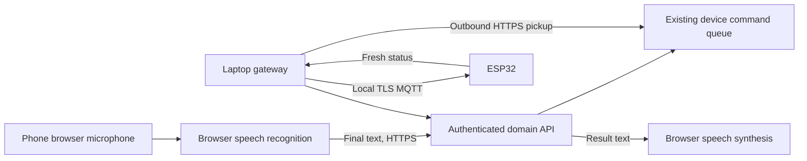

# Shared laptop and domain interface

The domain and laptop use the same frontend files and screens. Cloud mode no longer replaces Voice, Modules, Home details, Advanced, or Access cards with local-only placeholders.

| Feature | Domain behavior |
|---|---|
| Lights, fan, door commands | Existing durable command queue, gateway admission, local MQTT and fresh board confirmation. Door remains subject to its separate enable flags. |
| Microphone, chat, spoken replies, wake listening | Browser speech recognition and synthesis, using the same controls and language/voice preferences as localhost. Final transcripts use authenticated HTTPS instead of the local WebSocket. Device actions retain the voice-review dialog. |
| Home name, rooms, device names and assignments | Owner requests execute on the paired laptop through its existing API and version checks; the next gateway snapshot synchronizes the cloud catalog. |
| Access cards and keypad PIN | Same laptop handlers and encrypted local storage. Owner access and recent password confirmation are required for sensitive changes. This does not enable a disconnected door controller. |
| Modules and diagnostics | The paired laptop provides MQTT, board, camera configuration and resource diagnostics. Broker/camera changes retain local validation and password checks. |
| Alerts, activity, favorites and notifications | Existing household-scoped cloud records and preferences. |
| Online demo | Browser-only simulated controls, voice, sensor scenarios and generated camera preview. No physical request is sent. |

## Voice flow

The website enables microphone access for its own origin. Recognition and installed voices still depend on the browser and OS; the browser may use its speech provider online. HomeAuto receives recognized text, not microphone recordings. There is no direct phone-to-ESP32 or phone-to-laptop LAN connection.

## Management relay

The existing PostgreSQL household event journal carries short-lived management requests. Request bodies and results are encrypted with AES-256-GCM using the server-only `HOMEAUTO_HUB_RELAY_KEY` Vercel Secret. PINs, broker credentials and cloud session hashes are never placed into ordinary activity or event feeds. No database migration or new credential-table grant is needed.

Requests expire after 25 seconds. The gateway claims once, then redeems immediately before execution. Redemption rechecks the original cloud session, household, current owner role and required password confirmation. A bounded, clock-relative admission reaches an allowlisted loopback HTTP endpoint on the laptop through a temporary local session; that session is deleted after the call. Lost responses do not cause mutation replay. An uncertain response asks the owner to inspect current settings before retrying.

Telemetry and physical command processing continue independently of management requests. The cloud cannot choose an arbitrary URL, invoke authentication endpoints, or bypass the separate device-command path through this relay. A disconnected laptop produces an unavailable message.

## Verification

- Complete application suite: 293 tests passed.
- New integration tests cover Hindi dialogue/speech, browser microphone transport, local metadata execution, module diagnostics, sensitive-request encryption, owner restrictions, session revocation, cross-home isolation and duplicate admission rejection.
- Cloud parity browser checks cover microphone to spoken reply, common voice settings, an edit reaching local SQLite, slow module responses across multiple telemetry polls, and access-card/keypad screens; no page errors, external application requests, or cloud WebSockets.
- Cloud regression checks: 11 groups, 86 captures, no accessibility violations, page errors, or application CSP errors.
- Cloud build tracing permits only pure JavaScript intent/dialogue helpers; native hub modules remain excluded.

The current physical installation still has no PIR or door module. Their absence remains visible; interface parity does not manufacture hardware or sensor readings. Physical camera streaming is not claimed verified by module reachability checks.
