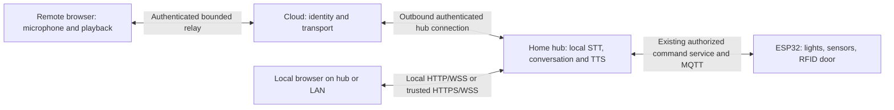

> Current voice update, 2026-11-15: [browser conversation implementation](../verification/BROWSER_VOICE_ASSISTANT.md). The user has replaced native speech with browser Web Speech recognition/synthesis and authenticated final-text WebSocket validation. No HomeAuto speech models or Python workers load. Downloaded assets/environments were moved outside the project into a recoverable archive; old native instructions and measurements below are historical. Start conversation alternates listening and speech with a 350ms quiet buffer. Browser recognition may require internet, and Automatic listening follows the app language rather than promising portable bilingual detection. Device execution, authentication and physical confirmation rules remain on the hub.

# Hub-owned AI and remote voice — revised implementation contract

Current local STT profile: multilingual Whisper medium via CPU INT8 faster-whisper, replacing the small Vosk baseline; Kokoro remains the English/Hindi TTS provider. [Installation and actual acceptance](../verification/WHISPER_UPGRADE.md). This local model change does not implement the remote relay described below.

2026-11-14. User-directed architecture change. This document supersedes earlier plans that required every website user to install/run AI on their own computer, or treated remote voice as indefinitely outside the product. It describes the target implementation; remote voice is not implemented by this documentation change.

## Required ownership

The **home hub** is the laptop/local computer connected to the ESP32 over Wi-Fi. It runs the local Node service, MQTT connection, offline STT, supported conversation/intent handling and TTS. All execution stays on this hub. A second laptop, phone or public-website browser is a client: it captures microphone input, displays transcripts/review/results, and plays returned audio. It needs no local model installation. The public site and cloud infrastructure authenticate and relay; they do not run speech models or claim to execute physical actions themselves.

“Offline AI” means locally executed models without an internet inference service. The hub still needs internet for public-site clients to reach it through the relay. If internet is unavailable, the hub and trusted same-LAN clients can continue through the local interface. Remote internet clients cannot reach a disconnected hub. The hub must stay powered, awake and running; a laptop screen being on is not proof its gateway/AI is ready.

The initial supported assistant remains the English/Hindi command/query grammar with spoken output. General free-form conversation is a separate future model feature, and when added it must also run on this hub under the same authority boundaries.

## Truthful capability and connectivity states

Track independently: hub enrollment; authenticated gateway freshness; hub service generation/epoch; STT readiness; TTS readiness; conversation service readiness; broker connectivity; board connectivity; per-device fresh reports; role and command policy. A fresh hub heartbeat alone does not make a device or voice worker available.

| Condition | Remote behavior |
|---|---|
| No hub enrolled | Offer Connect your home hub and explicit simulated demo alongside. |
| Hub offline/asleep/not connected | Disable remote capture, live conversation execution and new hardware commands. Say “Your home hub is offline. Start HomeAuto on the computer connected to your ESP32.” |
| Hub connected, STT unavailable | Disable microphone with setup/retry guidance for the hub owner. Manual controls can work if their independent device/policy gates pass. |
| TTS unavailable | Return supported text replies and explain unavailable spoken output. Do not unnecessarily disable permitted typed/manual controls. |
| Hub/voice ready, device offline | Queries return unavailable/qualified reports; physical commands fail safely. Voice readiness is not hardware readiness. |
| Connection lost during capture/inference/review | End/retire the conversation operation; do not play or execute delayed results on reconnect. Display retry/uncertainty as appropriate. |
| Command already admitted when disconnected | Preserve authoritative command history/uncertainty. Do not claim that cancel/closure undid an action already sent. |

No offline work queue may defer a newly spoken/typed device action for execution when the hub later wakes. Existing cloud queued state remains a short-lived admission/delivery stage after current-hub checks, not a sleep-until-online feature. Recheck readiness at creation, processing, user confirmation and local final admission. If connectivity fails between checks, expire/reject or report uncertainty; never silently replay the command.

## Target remote conversation protocol

1. Authenticate the website user and household membership. Bind a request to `{household, gateway, actor/session, conversation, utterance, hub_epoch, generation, expiry}`. Never accept a browser-selected gateway outside its household.
2. Create a short-lived, single-use voice upload capability only when the assigned hub and STT profile are currently ready. Acquire microphone only after an explicit tap. Stop playback before capture; preserve Finish recording/cancel behavior and bounded duration.
3. Relay bounded audio to the hub through its outbound authenticated connection. Do not expose inbound MQTT, distribute gateway secrets to clients or disable TLS/CORS/Origin checks. Current gateway telemetry-v1 does not carry audio: add a separately versioned conversation protocol rather than inserting audio into telemetry/report fields.
4. The hub validates ownership/expiry and runs its local recognizer. It returns actual transcript and supported interpreted target/action or clarification. Ambiguity/negation protections remain; do not pick the longest transcript or substitute a guessed room number.
5. For device actions, show the resolved request and require review. Confirmation carries a one-use hub-origin intent identity tied to the original actor/home/epoch; cloud transport cannot broaden it. Queries remain read-only. Remote unlocking remains prohibited under current policy.
6. Execute through the existing expiring command/admission service and Home.request, preserving audit identity, role, idempotency, no-replay and physical-evidence qualifications. Do not add a second direct model-to-MQTT route. Resolve exact integration with the existing remote command journal before implementation.
7. Construct a grounded text response and synthesize it on the hub. Relay owned, expiring audio back to the requesting client; audio jobs are separate from device commands and cannot trigger another action.
8. Stop/cancel/logout/home switch retires capture, buffers, pending inference output and playback for that owner. Native inference may finish after cancellation, but its stale result cannot commit or start a command. Every promise and busy owner must settle/clean up exactly once.

Current local limits are a20-second capture,16kHz mono PCM16 (maximum640,000 bytes), bounded frames and30-second pure inference timeout. Preserve these as initial ceilings, then budget additional remote transport time explicitly; do not extend a physical command's admission lifetime to accommodate speech. The intent/admission clock starts at the appropriate interpretation/confirmation stage, not at microphone permission request. Offline/local latency measurements are not remote latency guarantees.

## Relay implementation decision required before code

The current Vercel API uses short requests, a64KiB cloud request boundary and PostgreSQL-backed durable control state. A complete PCM recording does not fit that boundary. Do not raise all API limits or store raw audio in durable command/event/telemetry tables.

Evaluate a bounded chunk/request relay versus a dedicated authenticated streaming relay against actual hosting limits, backpressure, owner isolation, concurrent hubs, expiry and cost. Specify the chosen transport, storage/retention and cleanup before advertising availability. A chunked design needs bounded upload/download sizes, sequence/digest checks, per-user/home limits, single-use capabilities, cancellation, expiry and server-side cleanup. A streaming design needs reconnect semantics and must not assume one process owns all cloud sessions.

Prefer transient memory when a service can support the lifecycle. If temporary shared storage is required by the selected hosting architecture, explicitly document encryption/access controls, strict TTL and verified deletion, including logs/backups; do not repeat the old claim that all remote audio stays only in the hub's RAM. Local-only operation still saves no user recordings by default. State clearly in product privacy copy that remote voice traverses the relay for local processing.

This plan selects no new paid service, provisions no infrastructure, alters no SQL migration and introduces no cloud inference dependency. Use supported primary documentation to choose the transport at implementation time.

## Integration changes to implement

- Launcher/local setup: install models once on the **hub**, run the service/gateway while remote clients are active, show local versus remote readiness, and document Windows sleep/power/network effects. Do not globally disable sleep or modify firewall/trust without explicit setup choices.
- Gateway/protocol: publish supported conversation protocol version, hub epoch and individual worker readiness. Add scoped conversation delivery and cancellation without exposing credentials or replaying commands.
- Cloud API/auth: create/revoke scoped upload/conversation/review/audio capabilities and enforce current hub readiness. Keep device permission checks independent from speech readiness. Current cloud-side deterministic interpretation can remain a compatibility path until hub interpretation is implemented; it is not proof the target conversation route exists.
- Frontend: capability-driven local and remote capture adapters using the same interaction states; accurate disconnected guidance; review/focus, playback ownership, mobile support and all four themes. Remote clients should not be asked to install models if their household's hub is already set up.
- Response language: English/Hindi STT and TTS on the hub, selected by the user or verified supported language handling. No cloud/browser-speech fallback.
- Security/privacy: actor mapping between distinct local/cloud identities must be explicit and revocable; no account/password mirroring or guest-preview authorization. Do not treat a gateway token as unrestricted authority for every user action.

## Acceptance tests

1. Browser on laptop B has no model files or Python. It sends English/Hindi speech via the actual selected relay; laptop A's hub processes it, returns a review/text/audio response, and only approved simulated actions execute.
2. Stop/sleep/disconnect hub: public UI goes unavailable from current freshness; API denies new voice/control even if a browser cache says ready. Restart hub: old voice/confirmation/command IDs never execute automatically.
3. STT-only, TTS-only, failed/busy worker, offline broker and offline ESP are distinct, accurately reported states. A cloud site200 response is not hub health.
4. Test foreground/background, browser reload, two clients, household switch, logout/revocation, role change, hub replacement/epoch change, expired/tampered/duplicate/reordered chunks, replayed intent and delayed audio. Owner isolation must hold across every boundary.
5. Block WAN: local hub and same-LAN speech/manual controls still work; public remote features report unavailability. Restore WAN: only new explicit interactions proceed.
6. All tests use simulated hardware; physical commissioning is separate. Verify traffic that runs models/inference is confined to the hub and no cloud STT/TTS/LLM API is called. Native phone microphones, human accents and total remote latency need separately recorded acceptance.

## Current implementation boundary

The local English/Hindi demo has native speech and simulated control. Cloud voice endpoints currently return LOCAL_VOICE_ONLY and gateway transport is telemetry/commands, not audio. No remote microphone forwarding, shared conversation relay, remote voice review capability or returned hub-audio transport is implemented yet. Existing short-lived remote-light control already requires current gateway/device/policy evidence. Keep cloud microphone disabled until the complete new route passes acceptance; update copy to explain the hub requirement without claiming the relay is ready.
