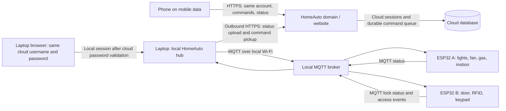

# Remote phone to local ESP32 hub

The phone never opens a connection to either ESP32 or to the laptop's LAN address. The laptop initiates outbound HTTPS to the domain. The ESP32 boards and laptop share a local Wi-Fi network; the phone may use any internet connection. The cloud and laptop are paired to one household using the private gateway connection file. A browser login on the laptop validates the same cloud username and password against that paired household, then issues a local-only session cookie. The cloud password is never stored in the local database.

## Command path for judges

1. The phone signs into the domain. A light or door command is checked against the cloud account and household, and recorded in the cloud command queue.
2. The laptop's outbound gateway poll uploads fresh board reports and receives at most four queued commands. The cloud gives each command one short lease.
3. Before any MQTT publication, the laptop redeems that lease with the cloud. Revoked sessions and expired commands fail here. The laptop also checks the local MQTT connection, the correct ESP32 board, and a fresh controller report.
4. The laptop publishes one nonretained MQTT command. The ESP32 reports its new state. Only this fresh report marks the command observed; a queued or published command is not proof of physical lock position.

Door unlock adds a fresh password reauthentication, an explicit confirmation dialog, and a 30-second confirmation bound to one command ID. Remote door control needs independent cloud and local enable flags. Lock control uses the same queue. RFID and keypad continue to operate on ESP32 B when the internet is down; their local events flow back to the laptop and then to the website when connectivity returns.

## Operator setup

1. Apply `server/online/migrations/005_remote_door.sql` through the reviewed online migration tool with the database owner connection before enabling door control. Keep the runtime database role restricted.
2. Keep the existing Vercel project connected to `main` with its current repository root setting. Root `vercel.json` now builds and serves the `website` copy and enables Git deployments. The build and CI both run `npm run site:check` to reject an unsynced copy. A later switch to Root Directory `website` is optional.
3. On the domain, sign in as the owner, reauthenticate, and download a private gateway connection file. Store it outside the repository. Launch the laptop with `node server/scripts/with-gateway.js PATH_TO_CONNECTION_FILE`.
4. Connect both boards and the laptop to the same Wi-Fi. Configure a local TLS MQTT broker with per-device credentials, secure laptop to broker access, and the laptop's current LAN address in both sketches. The Wi-Fi name alone does not determine the laptop's IP address.
5. After supervised door hardware testing, set `HOMEAUTO_DOOR_ENABLED=1`, `HOMEAUTO_REMOTE_DOOR_ENABLED=1`, `HOMEAUTO_SECURE_GATEWAY_APPROVED=1`, `HOMEAUTO_MQTT_ENABLED=1`, `HOMEAUTO_MQTT_BROKER=mqtts://...`, and broker credentials on the laptop. For remote lights, additionally set `HOMEAUTO_REMOTE_LIGHTS_ENABLED=1`.
6. After the migration and gateway are working, enable `HOMEAUTO_CLOUD_REMOTE_DOOR_ENABLED=1` and `HOMEAUTO_REMOTE_DOOR_APPROVED=1` in the cloud project. Remote lights require `HOMEAUTO_CLOUD_REMOTE_LIGHTS_ENABLED=1` and `HOMEAUTO_REMOTE_LIGHTS_APPROVED=1`. Both sides stay off by default.

The browser demo remains a software simulation. It cannot actuate either board. This flow was tested with simulated MQTT publication and controller reports; actual lock mechanics, Wi-Fi, and broker behavior require a supervised bench test with the two boards.
